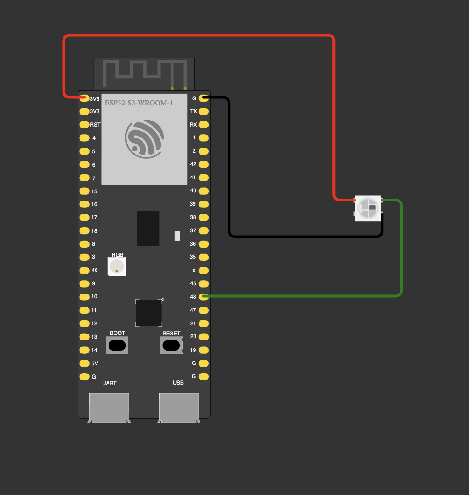

# 00 — Lecture blink (course demo)

Example code from the lecture. Three modes chosen at compile time with `#if` flags:
plain GPIO blink, LEDC PWM fade, or the onboard addressable RGB LED (`neopixelWrite`).
The RGB mode is enabled.

**Notes**
- With every flag at `0u` the preprocessor removes all branches and `loop()` is empty.
- `pinMode()` after `ledcAttachPin()` reconnects the pin to plain GPIO and silently stops PWM.
- `RGB_BUILTIN` is GPIO 48. Which pin drives the real board's onboard RGB LED (47 or 48) is not confirmed yet.
  Wokwi's DevKitC-1 has its RGB LED on GPIO 38, so the Wokwi circuit uses an external NeoPixel on GPIO 48.
