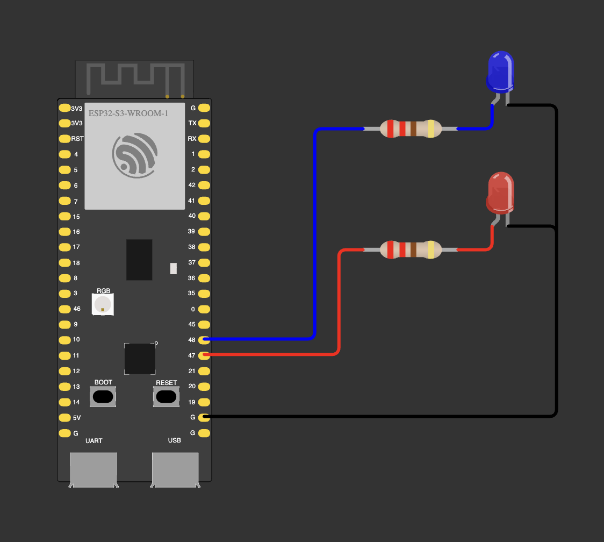

# 01 — Base: alternate blinking

Red and blue LEDs blink in turn every 100 ms.

| LED | GPIO |
|---|---|
| blue | 48 |
| red | 47 |

Each LED: GPIO → 220 Ω → LED anode, cathode → GND.

**Notes**
- Blue LEDs need about 3 V, so at 3.3 V a blue LED is visibly dimmer than a red one.
- Avoid GPIO 19/20 (native USB), 0/3/45/46 (strapping), 26–37 (flash/PSRAM), 43/44 (UART0).
