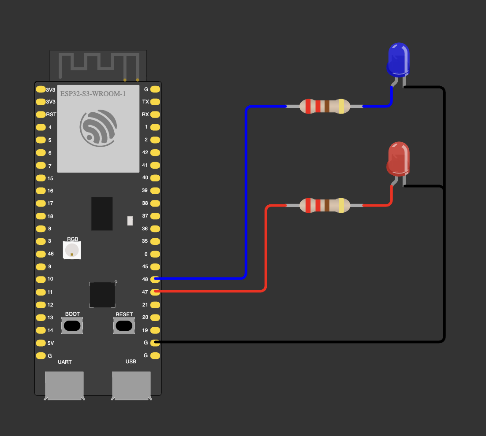

# 02 — Extra: double flash

Police-style rhythm: red flashes twice, short pause, blue flashes twice.
Timings live in `FLASH_MS` (60 ms) and `PAUSE_MS` (150 ms) instead of magic numbers.

Wiring is the same as [01](../01-base-alternate/).

**Notes**
- `delay()` blocks the CPU: during a cycle the chip can do nothing else.
  Non-blocking timing with `millis()` comes in module 2.
