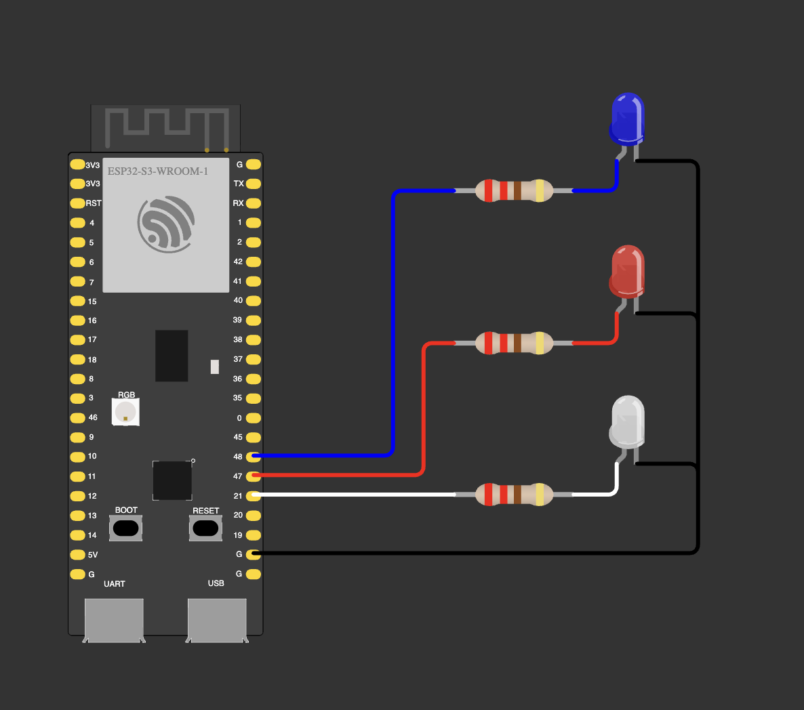

# 03 — Extra: third LED

A white LED in the middle: blue + white double flash, then white + red double flash.

| LED | GPIO |
|---|---|
| blue | 48 |
| red | 47 |
| white | 21 |

**Notes**
- GPIO 21 sits next to 19/20 (native USB) on the header, so a wire one hole off drops the USB connection.
- The two halves of `loop()` differ only in the pins. A pattern table of bits
  (e.g. `0b011`) would replace the copy-paste.
