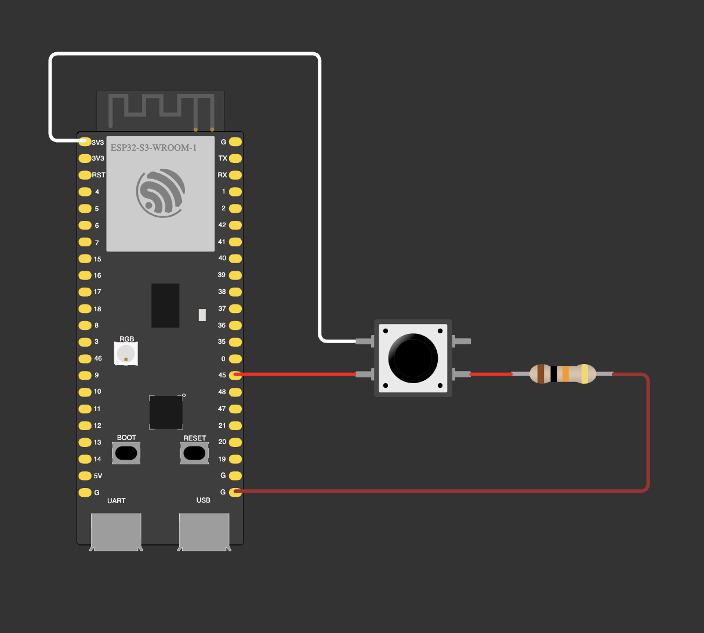

# 00 — Lecture: pull-down input

Class demo. GPIO 45 is an input with the internal pull-down (`INPUT_PULLDOWN`) plus an external 10 kΩ pull-down,
and a button connects it to 3V3. Every 100 ms the pin is read and printed to Serial:
`0` while the button is released, `1` while it is held.

| Part | GPIO |
|---|---|
| Button (other leg → 3V3) | 45 |
| 10 kΩ pull-down (other end → GND) | 45 |

**Notes**
- Pull-down mirrors the pull-up in the homework: idle = LOW, pressed = HIGH, because the button goes to 3V3, not to GND.
- A tactile button across the breadboard gap: the legs in one row are always connected, a press joins the two rows.
  3V3 goes in one row, the pin and the resistor in the other. With the pin in the 3V3 row the input reads `1` all the time.
- GPIO 45 is a strapping pin (flash voltage at reset, weak pull-down by default). HIGH on it during reset or
  power-on can keep the board from booting, so don't leave it tied to 3V3 across a reset.
- `Serial` is UART0: read it on the **UART** USB-C port (CH343P), not on the native USB port.
  `monitor_speed = 115200` must match `Serial.begin(115200)`, otherwise the monitor shows garbage.
