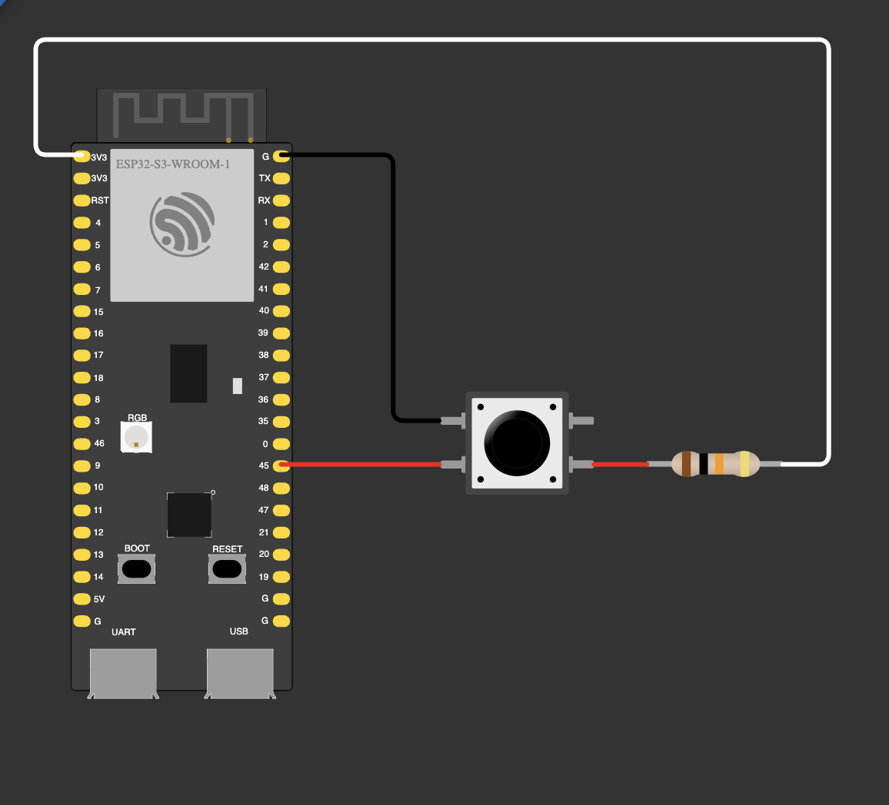

# 01 — Lecture: pull-up input

The [00](../00-lecture-pulldown/) demo turned around. A 10 kΩ resistor from 3V3 holds GPIO 45 HIGH, together with
the internal pull-up (`INPUT_PULLUP`), and the button pulls the pin to GND. Every 100 ms the pin is read and
printed to Serial: `1` while the button is released, `0` while it is held.

| Part | GPIO |
|---|---|
| Button (other leg → GND) | 45 |
| 10 kΩ pull-up (other end → 3V3) | 45 |

**Notes**
- Inverted logic: pressed = LOW. The external button in the homework works the same way.
- `INPUT_PULLUP` and the external 10 kΩ pull the same way, so together they act like ≈ 8.2 kΩ.
  With `INPUT_PULLDOWN` they would fight: 45 kΩ down against 10 kΩ up gives ≈ 2.7 V, barely above
  the 2.47 V HIGH threshold.
- GPIO 45 is a strapping pin: an external pull-up keeps it HIGH at every reset and power-on, which can select
  the wrong flash voltage and keep the board from booting (unless an eFuse fixes the voltage).
  A pin that isn't a strapping pin (e.g. GPIO 4) avoids that.
- `Serial` is UART0: read it on the **UART** USB-C port at 115200 baud.
