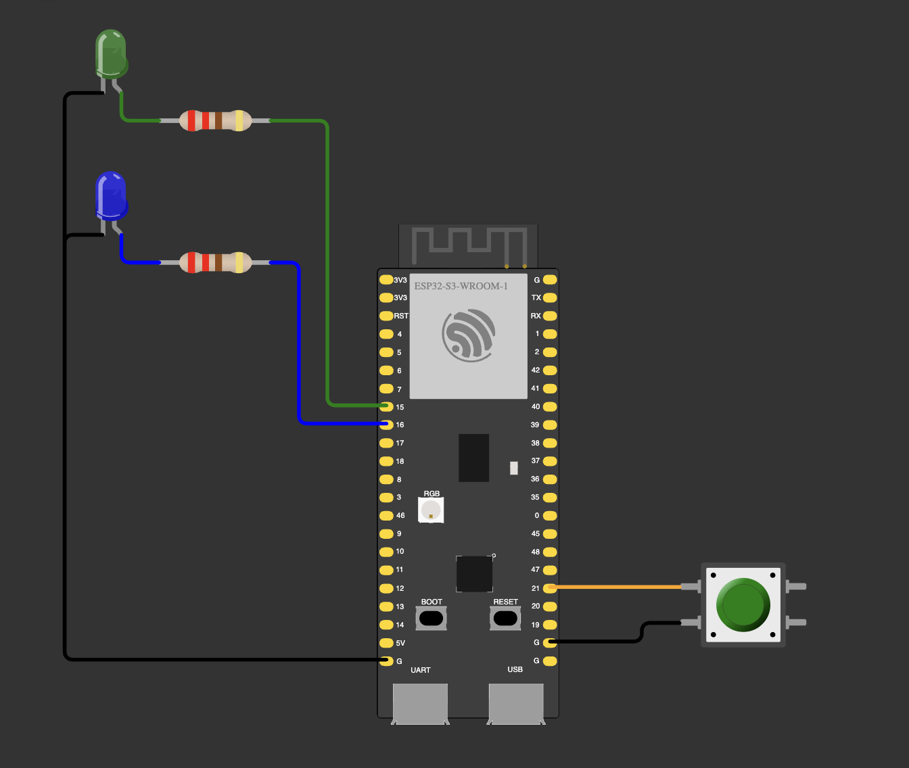

# 04 — Base: mode 2 while BOOT is held

**Assignment, mode 2 ("slow / in turn"):** selected by the onboard BOOT button (GPIO 0); the LEDs alternate
like a railway crossing with `delay(1000)`; BOOT is read as `INPUT`, because the board has an external pull-up.

Second stage of the homework: while BOOT is held, the LEDs alternate, 1000 ms each; when it is released both
go dark. Latching the mode comes in [05](../05-base-combined/).

| Part | GPIO |
|---|---|
| Green LED (through 220 Ω, cathode → GND) | 15 |
| Blue LED (through 220 Ω, cathode → GND) | 16 |
| BOOT button (on the board) | 0 |
| External button (wired, not used in this step) | 21 |

**Notes**
- `INPUT` turns the chip's internal pull-up off. GPIO 0 stays HIGH only because this board has an external
  pull-up next to the BOOT button (checked on the board). A board without it floats and acts as if BOOT were held.
- The circuit is the same as in [03](../03-base-mode1-sync/). Wokwi's DevKitC-1 model has no pull-up on GPIO 0,
  so in the simulation GPIO 0 reads LOW and the LEDs alternate without a press. On the real board they don't.
  Adding a 10 kΩ from GPIO 0 to 3V3 to `diagram.json` makes the simulation match the board.
- GPIO 0 is a strapping pin: holding BOOT while the program runs is fine, holding it during a reset or power-on
  starts the download mode instead of the program.
- One cycle takes 2000 ms and the button is read once per cycle, so the LEDs go dark up to 2 s after the release.
