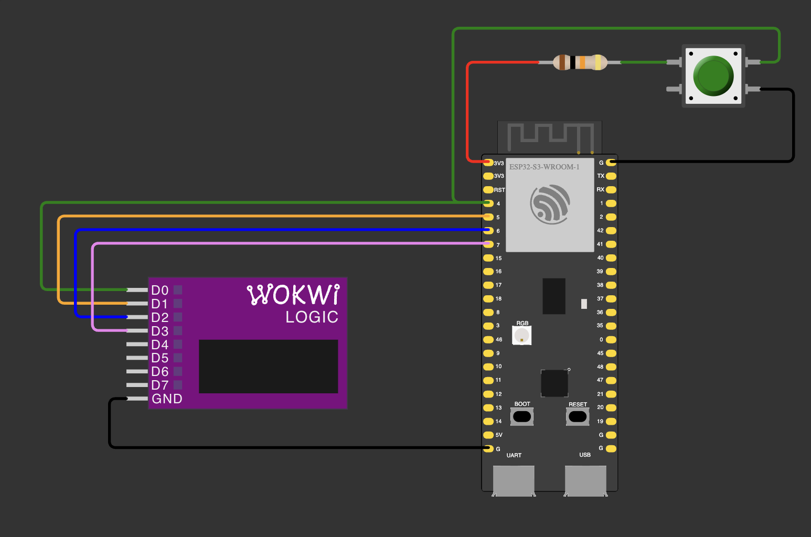
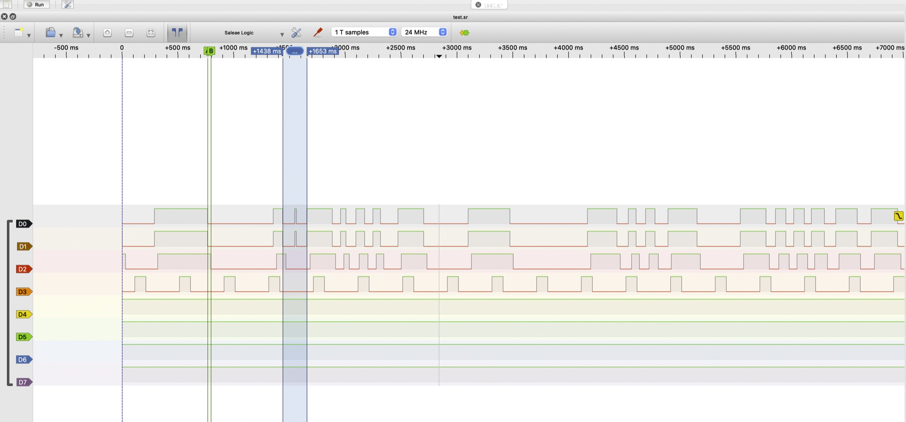

# 00 — Lecture: debounce on a logic analyzer

A button on GPIO 4 with an external 10 kΩ pull-up (`INPUT`, no internal pull-up) is watched by an interrupt on
`CHANGE`; comment out `USE_INTERRUPT_DEBOUNCE` to poll it in `loop()` instead. The firmware copies its
internal state to three pins, so the logic analyzer shows four views of one button:

| Channel | Pin | Shows | Like |
|---|---|---|---|
| D0 | GPIO 4 | the button itself: the physics | what really happened |
| D1 | GPIO 5 | RAW: the level the firmware last saw | the witness's notes |
| D2 | GPIO 6 | CLEAN: the level after the filter, accepted after 30 ms with no button activity | the judge's verdict |
| D3 | GPIO 7 | a steady square wave: 400 ms period, 100 ms HIGH | a ruler to check the timing |

Once a second it prints `RAW=<n> | DEBOUNCED=<n>`: presses counted with bounce, and after debouncing.

| Part | GPIO |
|---|---|
| Button (other leg → GND) + 10 kΩ pull-up (other end → 3V3) | 4 |
| Logic analyzer D0 (channel 1 on the case) | 4 |
| Logic analyzer D1 (channel 2) | 5 |
| Logic analyzer D2 (channel 3) | 6 |
| Logic analyzer D3 (channel 4) | 7 |
| Logic analyzer GND | GND |



## How the code works

**The idea.** It is the same idea as `debounce()` in JavaScript, which waits until the user stops typing
before it sends a search request: here a button level counts only after the button has been still for 30 ms.
The other half of the job is to let the analyzer see inside the firmware, so the internal state goes out on
pins (the table above). That is debugging through pins: a `digitalWrite` takes microseconds. A `Serial`
line needs about 2 ms on the wire at 115200 baud. In Arduino core 2.0.17 the call returns once the text is in
the UART's 128-byte hardware buffer, but printing more or more often waits for the wire, and either way it
shifts the very timing it is meant to show. Think metrics instead of logs: cheap enough to write all the time.

**Lines 1–14**

```cpp
#include <Arduino.h>
#define USE_INTERRUPT_DEBOUNCE
```

- `#include` pastes in the text of `Arduino.h` (`pinMode`, `digitalWrite`, `millis`): the preprocessor only
  substitutes text.
- `#define USE_INTERRUPT_DEBOUNCE` is a build-time switch. The preprocessor cuts the `#ifdef … #else … #endif`
  blocks below before compilation, so the unused variant never reaches flash. Comment the line out and
  rebuild to poll the button instead of using an interrupt. It works like a value a bundler substitutes at
  build time, not like a feature flag checked at run time.

```cpp
constexpr uint8_t BUTTON_PIN = 4;
constexpr uint8_t RAW_PIN = 5;
constexpr uint8_t CLEAN_PIN = 6;
constexpr uint8_t TEST_PIN = 7;
constexpr uint32_t DEBOUNCE_MS = 30;
```

- `constexpr`: a constant known at compile time. The compiler writes the number straight into the
  instructions, so it takes no RAM. Unlike `#define`, it has a type that the compiler checks.
- `uint8_t`: unsigned, 8 bits, 0–255, enough for a pin number. `uint32_t`: unsigned, 32 bits. `DEBOUNCE_MS`
  uses it because `millis()` returns `uint32_t`, and a comparison should use one type on both sides.
- Unlike a JavaScript `number`, a C++ integer type has a fixed size in bits, and a value that doesn't fit
  silently wraps around. That matters for `millis()` in `loop()`.

**Lines 16–42: the variables and the two modes**

```cpp
uint8_t stableState = HIGH;
uint32_t cleanPressCount = 0;
```

- Global, because `loop()` is called again and again and a local variable would be gone after every call.
- `stableState` is the accepted (debounced) level; it starts HIGH, the released button with a pull-up.
  `cleanPressCount` counts accepted presses. Only `loop()` touches them, so they need nothing special.

```cpp
#ifdef USE_INTERRUPT_DEBOUNCE
portMUX_TYPE buttonMux = portMUX_INITIALIZER_UNLOCKED;
volatile uint8_t lastRaw = HIGH;
volatile uint32_t lastRawChangeMs = 0;
volatile uint32_t rawPressCount = 0;
#else
uint8_t lastRaw = HIGH;
uint32_t lastRawChangeMs = 0;
uint32_t rawPressCount = 0;
#endif
```

- The same three variables in both modes: `lastRaw` is the last level seen, `lastRawChangeMs` the time of the
  last edge (milliseconds since boot, to measure how long the button has been still), `rawPressCount` the
  HIGH→LOW edges seen, bounce included (`RAW=` in the output).
- In interrupt mode the interrupt handler writes them while `loop()` reads them, so they are `volatile`:
  the compiler must read them from memory every time instead of reusing a copy in a register, because they
  change behind its back.
- `volatile` doesn't make the three values consistent with each other. If the interrupt fires after
  `loop()` has read `lastRaw` but before `lastRawChangeMs`, `loop()` combines a new level with an old time.
  That is a race condition. JavaScript never has it: synchronous code there is never interrupted in the
  middle. Here an interrupt can arrive between any two machine instructions.
- `buttonMux` is a spinlock, a "do not disturb" sign. `loop()` copies all three values inside
  `portENTER_CRITICAL()` / `portEXIT_CRITICAL()`, which turns interrupts off on this core and makes the
  other core wait, so it gets one consistent snapshot, like reading inside a database transaction. A
  handler can't wait for an ordinary mutex, but it can take a spinlock. Keep the protected part tiny: while
  it runs, interrupts wait.
- In polling mode only `loop()` touches the variables: no second writer, so no `volatile` and no lock.

**Lines 26–36: the interrupt handler**

```cpp
void ARDUINO_ISR_ATTR onButtonChange() {
  portENTER_CRITICAL_ISR(&buttonMux);
  const uint8_t raw = digitalRead(BUTTON_PIN);
  lastRawChangeMs = millis(); // Restart the quiet period on every interrupt.
  if (raw == LOW && lastRaw != LOW) {
    ++rawPressCount; // Includes bounce; fast edges can still be missed.
  }
  lastRaw = raw;
  portEXIT_CRITICAL_ISR(&buttonMux);
}
```

- `setup()` attaches it with `CHANGE`, so it runs on every edge in both directions, bounce included.
- The handler only records facts; `loop()` makes the decision. Like a guard who writes "the door changed at
  12:00:00.003" in a log and restarts a stopwatch, while someone else decides whether a guest really came.
- `ARDUINO_ISR_ATTR` expands to nothing in Arduino core 2.0.17, so the handler stays in flash. That is
  allowed: `attachInterrupt` registers the interrupt without the IRAM flag, so it is held back while the
  flash is busy. `IRAM_ATTR` would work too.
- `portENTER_CRITICAL_ISR` is the handler's version of the same lock `loop()` takes. Both sides must take
  the same lock, or it protects nothing.
- `CHANGE` doesn't say which way the pin went, so the handler reads the pin. It runs a few microseconds after
  the edge, and by then the pin may have bounced again: that is what "fast edges can still be missed" means.
- `lastRawChangeMs = millis()` runs on every interrupt, outside the `if`: every edge, a bounce or a real
  press, restarts the quiet period. JavaScript's `debounce()` does the same with `clearTimeout` +
  `setTimeout` on every keystroke.
- `rawPressCount` grows only on a change into LOW (`lastRaw != LOW`), so two interrupts in a row that both
  read LOW count once. `++` reads, adds and writes back; it is safe here because only the handler writes the
  value, inside the lock.
- No `delay()`, no `Serial`: the handler must finish in microseconds.

**Lines 44–62: `setup()`**

```cpp
Serial.begin(115200);
pinMode(BUTTON_PIN, INPUT); // External 10 kOhm pull-up required.
pinMode(RAW_PIN, OUTPUT);
pinMode(CLEAN_PIN, OUTPUT);
pinMode(TEST_PIN, OUTPUT);

lastRaw = digitalRead(BUTTON_PIN);
stableState = lastRaw;
lastRawChangeMs = millis();
digitalWrite(RAW_PIN, lastRaw);
digitalWrite(CLEAN_PIN, stableState);
digitalWrite(TEST_PIN, LOW);

attachInterrupt(digitalPinToInterrupt(BUTTON_PIN), onButtonChange, CHANGE);   // interrupt mode only
```

- `INPUT` turns the internal pull-up off, so the 10 kΩ resistor alone holds the pin HIGH. Without it the pin
  floats, and with `CHANGE` every bit of noise becomes an interrupt.
- GPIO 5, 6 and 7 are outputs. The analyzer's inputs draw almost no current, so the pins only set a level.
- The starting state comes from the real pin, not from a guess: if the button is held while the board
  boots, the program neither counts a press nor sees a fake release. The quiet period starts at boot.
- RAW and CLEAN start at the same level as the button, so the analyzer channels agree from the first sample.
- `attachInterrupt` comes last. Until then nothing else writes the shared variables, so `setup()` can set
  them without the lock; an interrupt that fired earlier could be overwritten by the initial read.
- `digitalPinToInterrupt()` maps a pin to its interrupt number. Every ESP32 GPIO can interrupt, so it
  changes nothing here; it keeps the sketch portable to boards like the Uno, where only some pins can.

**Lines 64–110: `loop()`**

```cpp
portENTER_CRITICAL(&buttonMux);
const uint8_t raw = lastRaw;
const uint32_t lastChangeMs = lastRawChangeMs;
const uint32_t rawCount = rawPressCount;
const uint32_t now = millis();
portEXIT_CRITICAL(&buttonMux);
```

- Interrupt mode: one consistent snapshot under the lock, then `loop()` works only with these local copies.
- `now` is read last, still under the lock. Read before the copy, an interrupt in between could make
  `lastChangeMs` newer than `now`; `now - lastChangeMs` would then wrap around to about 4.29 billion, and
  the debounce would pass at once.
- Polling mode (`#else`) reads the pin itself on every pass and does the handler's bookkeeping: a change
  restarts the quiet period, and a change into LOW is counted.

```cpp
digitalWrite(RAW_PIN, raw);
if (raw != stableState &&
    static_cast<uint32_t>(now - lastChangeMs) >= DEBOUNCE_MS) {
  stableState = raw;
  if (stableState == LOW) {
    ++cleanPressCount;
  }
}
digitalWrite(CLEAN_PIN, stableState);
```

- The decision: the level differs from the accepted one **and** nothing has moved for 30 ms. Only then is the
  new level accepted, and only a press (LOW) is counted. CLEAN therefore follows the button 30 ms after the
  last bounce (29–30 ms measured: `millis()` counts whole milliseconds).
- `now - lastChangeMs` on `uint32_t`: `millis()` wraps from 4 294 967 295 back to 0 after 49.7 days. Unsigned
  subtraction still gives the right elapsed time across the wrap, like a 12-hour clock: from 11 to 1 is
  (1 − 11) mod 12 = 2 hours. A test like `now >= lastChangeMs + DEBOUNCE_MS` would break at the wrap.
  JavaScript's `Date.now()` never wraps, so the problem doesn't exist there.

```cpp
digitalWrite(TEST_PIN, (now % 400U) < 100U ? HIGH : LOW);
```

- HIGH for the first 100 ms of every 400 ms: a 2.5 Hz square wave, 25 % duty cycle. It comes from `millis()`
  and `loop()`, not from a hardware timer, so its edges wander by a few microseconds (jitter). `U` makes
  the literals unsigned, so the arithmetic stays unsigned.

```cpp
static uint32_t lastReportMs = 0;
if (static_cast<uint32_t>(now - lastReportMs) >= 1000U) {
  lastReportMs = now;
  Serial.printf("RAW=%lu | DEBOUNCED=%lu\n",
                static_cast<unsigned long>(rawCount),
                static_cast<unsigned long>(cleanPressCount));
}
```

- A `static` local keeps its value between calls, like a global that only `loop()` can see.
- Once a second, with the same wrap-safe subtraction. `%lu` expects an `unsigned long`; the cast makes it
  correct whatever type `uint32_t` is on a given toolchain.

**Measured on the board**

[`capture.sr`](capture.sr): PulseView 0.4.2, 24 MHz (one sample = 41.7 ns), 9.06 s. Open it in PulseView.



The shaded part (1438–1653 ms) is the press with a 14.9 ms gap: D0 and D1 jump HIGH for a moment,
D2 stays LOW. D2 follows D0 about 30 ms late all along; D3 is the reference square wave.

| Channel | Signal | Result |
|---|---|---|
| D0 | button | 32 HIGH→LOW transitions; bounce only on releases |
| D1 | RAW | follows D0 6.5–12.8 µs later (median 8 µs); 30 HIGH→LOW transitions |
| D2 | CLEAN | 23 presses; switches 29–30 ms after the last edge on D0 |
| D3 | reference | period 400.016–400.020 ms |

Bounce on D0 and the same moments on D1:

| Time, s | D0: transitions | D0: shortest pulse | D1: transitions |
|---|---|---|---|
| 4.535 | 5 | 0.21 µs | 3 |
| 6.711 | 3 | 70 µs | 3 |
| 7.317 | 5 | 9.6 µs | 5 |
| 7.745 | 3 | 26.8 µs | 3 |
| 7.950 | 3 | 0.96 µs | 1 |
| 8.543 | 3 | 0.63 µs | 1 |

D0 also stayed HIGH for only 14.9 ms during one press and for 24.2 ms between two presses. Both are shorter
than the 30 ms window, so D2 treated them as bounce and merged them.

**Notes**
- `INPUT` turns the internal pull-up off: without the external 10 kΩ the pin floats and reads random levels.
  Wokwi doesn't show that: its floating pin reads 0.
- The analyzer's GND must be connected to the board's GND, or it has no reference to measure against.
- The case labels the analyzer channels 1–8; Logic 2 and PulseView call them D0–D7.
- A debounce window also swallows real presses or releases shorter than the window (the 24.2 ms gap above).
- The board and the analyzer each count time with their own crystal. They disagree by about 40 ppm, which
  is why the 400 ms reference measures as 400.016 ms.
- Printing once a second shifts the timing of D1 and D3 slightly (the code says so).
- Logic 2 and PulseView can't share the analyzer: each loads its own firmware into it. Close one and replug
  the analyzer before using the other.
