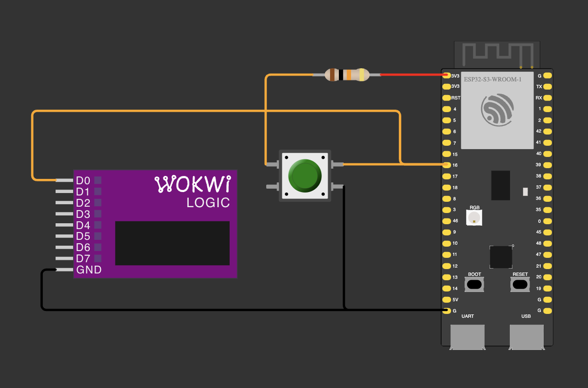

# 01 — Base: count presses with an interrupt

The assignment: measure the contact bounce of a button and compare the real number of pulses (logic analyzer)
with what the microcontroller catches through a hardware interrupt, over 10 presses of different speed and force.

The button on GPIO 16 has a pull-up: an external 10 kΩ to 3V3 plus `INPUT_PULLUP`. An interrupt on `FALLING`
(a HIGH→LOW edge) adds 1 to `button_counter`, and `loop()` prints `Button Pressed! Count: N` whenever the count
changes. The logic analyzer watches the same pin.

| Part | GPIO |
|---|---|
| Button (other leg → GND) | 16 |
| 10 kΩ pull-up (other end → 3V3) | 16 |
| Logic analyzer D0 (channel 1 on the case) | 16 |
| Logic analyzer GND | GND |

## Measured on the board

Capture: Logic 2, 24 MS/s (one sample = 41.7 ns), channel D0 on GPIO 16, 10 presses of different speed and force,
2026-10-14 23:07. Button with a 10 kΩ pull-up to 3V3 plus `INPUT_PULLUP`. The board was not reset: the counter
stood at 170 before the capture and at 206 after it. The Serial Monitor printed each new count with the time it
arrived (`monitor_filters = time`), 29–39 ms after the matching edge on D0, so every line maps to one press or
release.

Raw data: [`capture.sal`](capture.sal), open it in Logic 2.

### Bounce per press

Bounce pulses = (transitions − 1) / 2. Duration = from the first to the last transition of the press or release.

| # | Press: bounce pulses | Press: bounce, ms | Release: bounce pulses | Release: bounce, ms |
|---|---|---|---|---|
| 1 | 0 | — | 0 | — |
| 2 | 0 | — | 0 | — |
| 3 | 0 | — | 1 | 0.126 |
| 4 | 0 | — | 0 | — |
| 5 | 0 | — | 2 | 0.373 |
| 6 | 0 | — | 0 | — |
| 7 | 0 | — | 2 | 0.065 |
| 8 | 0 | — | 1 | 0.200 |
| 9 | 0 | — | 0 | — |
| 10 | 0 | — | 0 | — |

Total: 6 bounce pulses, all on releases. Shortest pulse 2.87 µs (release 5).

A bouncing release up close (from an earlier capture, 2026-10-13): HIGH, back to LOW for 51 µs, HIGH for 6 µs,
LOW for 126 µs, then HIGH for good.

### Analyzer vs microcontroller

The counter counts `FALLING` interrupts, so the analyzer column counts HIGH→LOW transitions. Both columns are split
into the press and its release.

| # | Analyzer: HIGH→LOW (press + release) | MCU: counter increments (press + release) |
|---|---|---|
| 1 | 1 + 0 | 1 + 1 |
| 2 | 1 + 0 | 1 + 1 |
| 3 | 1 + 1 | 1 + 4 |
| 4 | 1 + 0 | 1 + 1 |
| 5 | 1 + 2 | 1 + 6 |
| 6 | 1 + 0 | 1 + 1 |
| 7 | 1 + 2 | 1 + 5 |
| 8 | 1 + 1 | 1 + 4 |
| 9 | 1 + 0 | 1 + 1 |
| 10 | 1 + 0 | 2 + 1 |
| **Total** | **16** (10 + 6) | **36** (11 + 25) |

**Notes**
- `INPUT_PULLUP` and the external 10 kΩ pull the same way, so together they act like ≈ 8.2 kΩ.
- `Serial` is UART0: read it on the **UART** USB-C port. On macOS its CH343P bridge also shows up as
  `/dev/cu.usbmodem…`; the vendor ID tells the ports apart (1A86 = UART, 303A = native USB).
- `monitor_filters = time` puts the arrival time in front of every monitor line. That is how each count was
  matched with an edge in the capture.
- Logic 2 can't change the input threshold of this analyzer clone: it is fixed.
