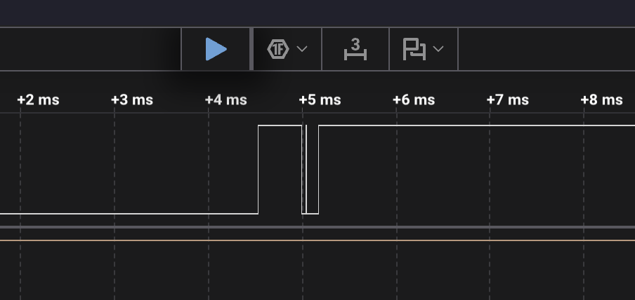

# 1.5 homework: bounce measurements

Capture: Logic 2, 24 MS/s (one sample = 41.7 ns), 5 s, channel D0 on GPIO 16, 2026-10-13 20:27. 10 presses.

## Bounce per press

Bounce pulses = (transitions − 1) / 2. Duration = from the first to the last transition of the press or release.

| # | Press: bounce pulses | Press: bounce, ms | Release: bounce pulses | Release: bounce, ms |
|---|---|---|---|---|
| 1 | 0 | — | 2 | 0.201 |
| 2 | 0 | — | 1 | 0.154 |
| 3 | 0 | — | 0 | — |
| 4 | 0 | — | 0 | — |
| 5 | 0 | — | 1 | 0.702 |
| 6 | 0 | — | 0 | — |
| 7 | 0 | — | 0 | — |
| 8 | 1 | 0.008 | 2 | 0.645 |
| 9 | 0 | — | 1 | 0.025 |
| 10 | 0 | — | 0 | — |

Total: 8 bounce pulses, 1 on a press and 7 on releases. Two pulses are at the analyzer's resolution limit:
release 2 (1 sample) and press 8 (2 samples).

Release 8 in Logic 2:

## Analyzer vs microcontroller

The counter counts `FALLING` interrupts, so the analyzer column counts HIGH→LOW transitions.

| # | Analyzer: HIGH→LOW | MCU: counter increments |
|---|---|---|
| 1 | 3 | ? |
| 2 | 2 | ? |
| 3 | 1 | ? |
| 4 | 1 | ? |
| 5 | 2 | ? |
| 6 | 1 | ? |
| 7 | 1 | ? |
| 8 | 4 | ? |
| 9 | 2 | ? |
| 10 | 1 | ? |
| **Total** | **18** | **?** |

The MCU column needs a run where the board is reset right before the capture. If the run is repeated,
both tables are redone from the new capture.
