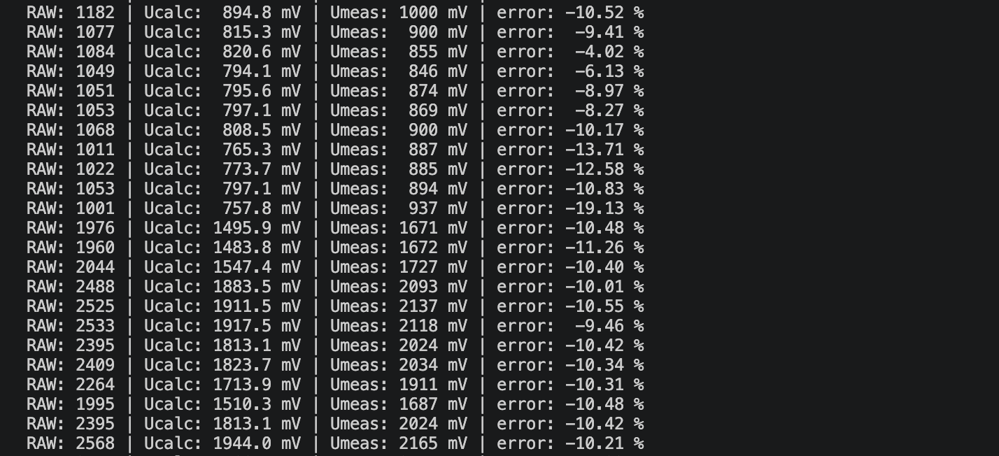

# 01 — Base: the ADC voltage by formula vs `analogReadMilliVolts()`

The assignment: an LDR in a voltage divider; every 100 ms read the raw ADC code with `analogRead()`, compute the
voltage as RAW / ADCmax × Uref with ADCmax = 4095 and Uref = 3.1 V, read the voltage with
`analogReadMilliVolts()`, work out the relative error in percent and print all of it.

The firmware sets the ADC to 12 bits and 11 dB on GPIO 4 and then, every 100 ms (a non-blocking `millis()`
period, so the time the code itself takes doesn't stretch it), prints one line:

```
RAW: 2659 | Ucalc: 2012.9 mV | Umeas: 2235 mV | error:  -9.94 %
```

- `Ucalc` = RAW / 4095 × 3100 mV, the straight-line formula from the assignment.
- `Umeas` = `analogReadMilliVolts()`, which applies the chip's own calibration. It is taken as the reference.
- `error` = (Ucalc − Umeas) / Umeas × 100. Negative means the formula reads lower. When Umeas is 0 there is
  nothing to compare against, and the line ends with `error: n/a` instead of a division by zero.

| Part | GPIO |
|---|---|
| LDR (other leg → 3V3) and 10 kΩ (other end → GND), their midpoint | 4 |

The circuit on the breadboard:

```
3V3 ── LDR ──┬── GPIO 4
             │
           10 kΩ
             │
            GND
```


**Wokwi** has no bare LDR, only a photoresistor module. The module carries its own 10 kΩ, which is why the Wokwi
circuit shows no separate resistor, and it sits on the other side (10 kΩ to VCC, LDR to GND): more light gives a
lower voltage. The real circuit can't be drawn in Wokwi either: it doesn't solve resistor dividers, and two 10 kΩ
resistors in series read as 4095 there, not 2048. Use Wokwi to run the code, not for the numbers.

## Measured on the board

Room light, eight lines in a row:

| RAW | Ucalc, mV | Umeas, mV | error, % |
|---|---|---|---|
| 2633 | 1993.2 | 2220 | −10.21 |
| 2652 | 2007.6 | 2233 | −10.09 |
| 2661 | 2014.4 | 2238 | −9.99 |
| 2659 | 2012.9 | 2233 | −9.86 |
| 2662 | 2015.2 | 2238 | −9.96 |
| 2667 | 2019.0 | 2246 | −10.11 |
| 2660 | 2013.7 | 2231 | −9.74 |
| 2659 | 2012.9 | 2235 | −9.94 |

- With Uref = 3.1 V the formula reads about 10 % below the calibrated value. The Uref that would make the two
  agree at this point is 2235 / 2659 × 4095 ≈ 3440 mV; the lesson's 3.3 V would give about −4 %.
- The error wanders between −9.74 and −10.21 %: RAW (2633–2667) and Umeas (2220–2246) are two separate
  conversions, so ADC noise goes straight into the error. The second decimal means nothing.

A second run, the LDR covered by hand and then uncovered:



- Covered (Umeas 846–1000 mV) the error scatters from −4 to −19 %: the hand moves between the two conversions,
  and the same few millivolts weigh more at a lower voltage. Uncovered (1671–2165 mV) it stays at −9.5…−11 %.
- On average Ucalc / Umeas is 0.90 in both ranges, so the formula and the calibration differ by a scale factor
  (the Uref), not by an offset: on this chip a Uref of about 3460 mV would fit from 0.9 V to 2.2 V.

**Notes**
- `raw / ADC_MAX` with two integers is an integer division: 0 for every RAW below 4095. One operand must be a
  `float` before the division (`static_cast<float>(raw)`). The compiler gives no warning.
- `uint32_t` can't hold the negative difference `Ucalc − Umeas`: in an unsigned type it wraps to about 4.29
  billion. The error is a `float`.
- Near 0 V (a covered LDR) the relative error grows, because it divides by a small Umeas. At Umeas = 0 a `float`
  division gives `inf`, and an integer division by zero crashes and resets the board: hence the check.
  Above about 3.1 V the ADC reads 4095 and the formula stops at 3100 mV.
- The print uses `%lu` with a cast to `unsigned long`: `uint32_t` is an `unsigned int` in Arduino core 2.0.17
  and an `unsigned long` in core 3.x, so a plain `%u` fits only the first.
- Only a multimeter on GPIO 4 tells which of the two voltages is closer to the truth.
