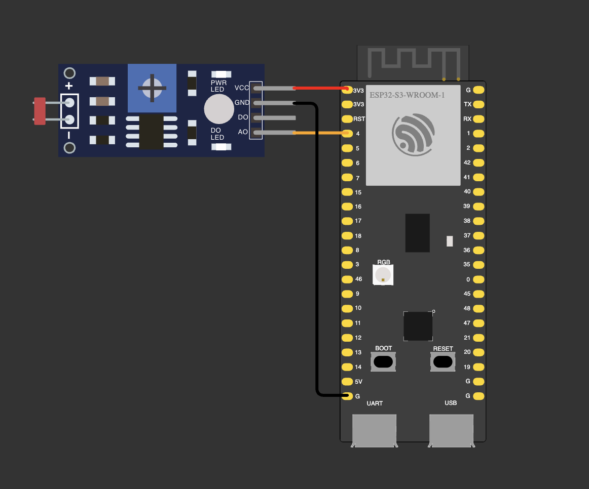

# 01 — Base: the ADC voltage by formula vs `analogReadMilliVolts()`

The assignment: an LDR in a voltage divider; every 100 ms read the raw ADC code with `analogRead()`, compute the
voltage as RAW / ADCmax × Uref with ADCmax = 4095 and Uref = 3.1 V, read the voltage with
`analogReadMilliVolts()`, work out the relative error in percent and print all of it.

The firmware sets the ADC to 12 bits and 11 dB on GPIO 4 and then, about every 100 ms (`delay(100)`), prints one line:

```
RAW: 2659 | Ucalc: 2012.9 mV | Umeas: 2235 mV | error:  -9.94 %
```

- `Ucalc` = RAW / 4095 × 3100 mV, the straight-line formula from the assignment.
- `Umeas` = `analogReadMilliVolts()`, which applies the chip's own calibration. It is taken as the reference.
- `error` = (Ucalc − Umeas) / Umeas × 100. Negative means the formula reads lower.

| Part | GPIO |
|---|---|
| LDR (other leg → 3V3) and 10 kΩ (other end → GND), their midpoint | 4 |



**Wokwi** has only a photoresistor module, wired the other way round (more light = lower voltage), and its ADC is
ideal (3.3 V = 4095), so its numbers differ from the board's.

## Measured on the board

Room light, eight lines in a row:

| RAW | Ucalc, mV | Umeas, mV | error, % |
|---|---|---|---|
| 2633 | 1993.2 | 2220 | −10.21 |
| 2652 | 2007.6 | 2233 | −10.09 |
| 2661 | 2014.4 | 2238 | −9.99 |
| 2659 | 2012.9 | 2233 | −9.86 |
| 2662 | 2015.2 | 2238 | −9.96 |
| 2667 | 2019.0 | 2246 | −10.11 |
| 2660 | 2013.7 | 2231 | −9.74 |
| 2659 | 2012.9 | 2235 | −9.94 |

- With Uref = 3.1 V the formula reads about 10 % below the calibrated value. The Uref that would make the two
  agree at this point is 2235 / 2659 × 4095 ≈ 3440 mV; the lesson's 3.3 V would give about −4 %.
  Either way it is a straight line, while the chip is calibrated with a curve, so the error changes with the voltage.
- The error wanders between −9.74 and −10.21 %: RAW (2633–2667) and Umeas (2220–2246) are two separate
  conversions, so ADC noise goes straight into the error. The second decimal means nothing.

**Notes**
- `raw / ADC_MAX` with two integers is an integer division: 0 for every RAW below 4095. One operand must be a
  `float` before the division (`static_cast<float>(raw)`). The compiler gives no warning.
- `uint32_t` can't hold the negative difference `Ucalc − Umeas`: in an unsigned type it wraps to about 4.29
  billion. The error is a `float`.
- Near 0 V (a covered LDR) the relative error grows, because it divides by a small Umeas; at Umeas = 0 it is
  infinite. Above about 3.1 V the ADC reads 4095 and the formula stops at 3100 mV.
- `%u` matches `uint32_t` in Arduino core 2.0.17, where it is an `unsigned int`. In core 3.x it is an
  `unsigned long`, and `%lu` with a cast is needed.
- Only a multimeter on GPIO 4 tells which of the two voltages is closer to the truth.
