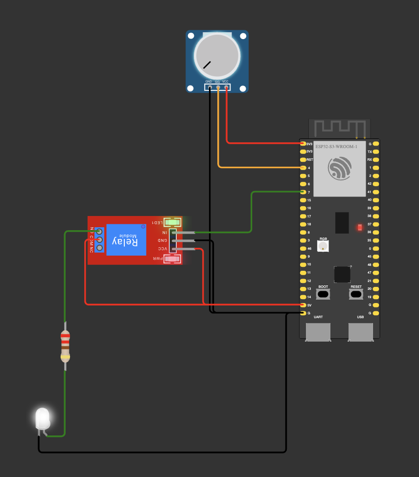
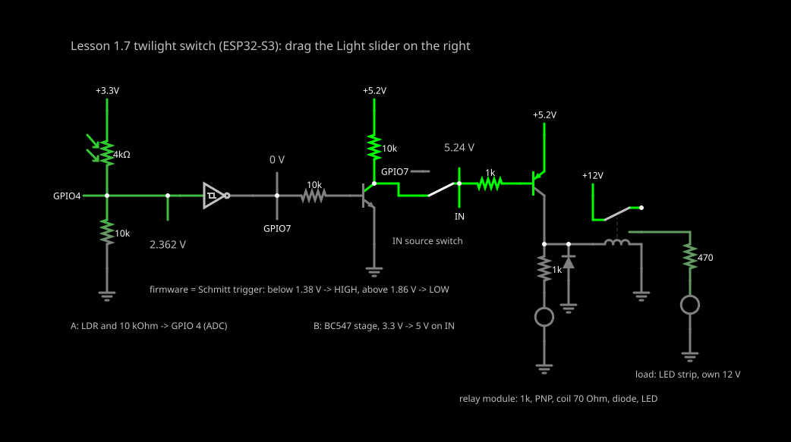
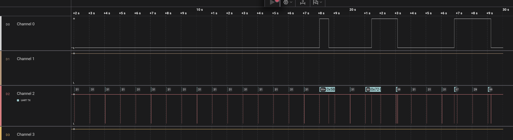

# 00 — Base: a twilight switch (an LDR and a relay behind a BC547)

The lesson 1.7 homework as given. An LDR divider on GPIO 4 (ADC1) measures the light, and GPIO 7 ("GPIO Out")
switches a relay module through a BC547B stage. Every 100 ms the firmware reads the raw ADC code and applies
hysteresis: below `THRESHOLD_DARK` = 1600 it sets GPIO 7 HIGH (relay on), above `THRESHOLD_LIGHT` = 2200 it sets
it LOW (relay off), and in between it changes nothing. Once a second it prints a status line, and one more line
whenever the relay changes (the time in brackets is the uptime):

```
raw: 2915 | light | relay: off
[  910.4 s] relay on (dark)
raw: 716 | dark | relay: on
[  914.8 s] relay off (light)
```

| File | What it does |
|---|---|
| `include/config.h` | pins, periods, thresholds (`static_assert` rejects swapped ones) and `RELAY_ON_IS_HIGH` |
| `src/light_sensor.cpp` | 12-bit ADC at 11 dB on GPIO 4, one sample per 100 ms, the hysteresis state (starts as light) |
| `src/lamp.cpp` | the only code that writes GPIO 7: the off level goes in before `pinMode(OUTPUT)`; one line per change |
| `src/main.cpp` | the superloop: sample, update the relay, a status line every 1000 ms; no `delay()` |

| Part | GPIO |
|---|---|
| LDR (other leg → 3V3) and 10 kΩ (other end → GND), their midpoint ("GPIO In") | 4 |
| BC547B base, through R3 = 10 kΩ ("GPIO Out") | 7 |

The circuit on the breadboard (+5 V comes from a breadboard power supply, see below):

```
3V3 ── LDR ──┬── GPIO 4 (ADC1)            GPIO 7 ── 10 kΩ (R3) ── B  BC547B
             │                                                    E ── GND
           10 kΩ (R2)                      +5 V ── 10 kΩ (R4) ──┬── C
             │                                                  └── relay module IN
            GND                            relay module VCC = +5 V, GND common

Load, on its own supply: supply + ── COM, NO ── load +, load − ── supply −
One ground: the board's GND, the breadboard supply's GND, the relay module's GND, the BC547B emitter.
```




**Wokwi** can't draw this circuit as it is. It doesn't solve resistor dividers and its photoresistor module runs the
other way (more light = lower voltage), so a potentiometer on GPIO 4 stands in for the light: turned down = dark.
There is no transistor in the Wokwi circuit: its relay module sits straight on GPIO 7, with VCC on the board's 5V
pin, which only works in the simulator. A 220 Ω resistor and an LED on NO (COM on 5V) show the lamp: it lights
in the dark and goes off in the light, so Wokwi's relay module switches on at IN = HIGH, as on the board.

**Falstad** simulates the electrics that Wokwi skips: [open the circuit in Falstad](https://www.falstad.com/circuit/circuitjs.html?ctz=CQAgjCAMB0l5AmcMFwQdnQZkgDgQGwCcR6IArJBRVeQKYC0YYAUAEogEAsnP3IWJFSpcqWaFihSY5FlnR9FvcOgLTopSBAAyASwDmACwAuAHQDOACgBOAe1sBbC6QA0FgCYBDawGsL5cgBKFmtlMFVlDCFkeBZ9SPQkfhweYRYAdzCIsC4ecLVIDPBclTUwAip8qBYAeWK87JKEUXBq1DJ+KvLSkB4AcQAFAEkarhYwXElyyoiEcjKI4WhycAlcVdw1cUlCzLmFtQRcdarCuqOT2ePwI9bC9pALnqeEZt6QQZH0EMfrqqxcA0CjE4CxjAJAT0uN1TncpDgqO46AAzTwAVwANsYitCykQkLjHi1CvFCc0RN0otJ2L1uvxCYJpL1aNA3sIoMsfoT6TCKlIwPBdrSynzcic+UKxeBRVxLgUcbKobgZvKAMoUW7TXrK6XsqiojHmOhSBAsB6yyolKU5Hj9YY1b4PciavnO9aodY8IYAOVqGvFtE1YCQEEKoTdus4eEjlVi4IqAd4lQlICYTNQiJR6KxRW4lsUVCI8o4eZARaTynZLXIrNS6lkmVLVVL5OqjZarYIiSJaUb3db6EgPFbhXC60Hw+jqnd0byHOiMEgKwFgsFHKXPEH68gZEXS7bIGnPcPBHd3ZJJ7PSCPKWp7k4-euXaQraQSNRmOx8Wfv3WP8Eeo-C2LSlresaguUSQtLeoGnkyoZxBWWBwaWoiARwE49JhNpMtWTIyEU2ERJhHoHkerw8JML5sj8VGPG8dFPCIg7jAQSCMdcdFYM6-KtKw8RcTxXGQmkAAe0qpt0eoSdodDmOYtgAHarGQxjpLoGIGCYIDmOpxgAMaGCAlgAKKqgMggMKqWCBAAXCA7jWJ48TGIYxp6EY4LmJpSKhEpICuca1hadi4ndNxC78kgACC9naAAIhwniKfeAogD4NSGA4qYAHwfPa7yWNF8UAMLBGFqACEO+E3CAyK6NYDjpN4xoALwgKqhkOLoxjgsYwX6PodDWPZABGdAYrYmRgGsIAAGq5SAAASQx9EtLggJ4o22AAbsaM2bPNi3aDUADqLDiVgyECDx0nBiAABC9kPSV5BcGQ5jGM5dAbdsR0MHlKwLf5PoXb0HbEvBSA+jpthotY+nGrpPWGWDEZSndSDWBNngAJ4gA4tjuJidD2WAPgbQM3oDBt+m2Bph5UJlDgbe4uhEz9IDaCZ8Vg6oFLAuy92TZ47hxTzOn9boAAOG1TcpACqqoPdQc0sEAA)
(or File → Import From Text with [`falstad.txt`](falstad.txt)). The firmware is replaced by an inverting Schmitt
trigger with the thresholds in volts (1.38 / 1.86 V). Drag the "Light" slider: 97 is room light (LDR ≈ 4 kΩ,
GPIO 4 = 2.36 V, the same as the multimeter), the relay switches on at 86 and off again at 94, and in between it
keeps its state. The switch next to IN feeds IN straight from GPIO 7: then the relay stays on in the light and in
the dark. Model values: default transistors (β 300 and 200), a 70 Ω coil that pulls in at 54 mA and drops out at
7 mA; Falstad's LDR is a linear model, not a real light curve.



## Measured on the board

**Before wiring.**
- The board's 5V pin, with USB plugged in: about 1 V. On this clone the IN-OUT solder pad is open, so USB power
  doesn't reach the pin. The relay module and R4 get +5 V from a breadboard power supply (MB-102 type, fed
  over USB): 5.24 V on its rail.
- The relay module: pins VCC, GND, IN; screw terminals NO, COM (middle), NC; a JQC3F-05VDC-C relay. Touching IN to
  GND clicks it: a low-level trigger, so `RELAY_ON_IS_HIGH = true` (see the notes).
- The BC547B, flat side facing, legs down, multimeter diode test: red probe on the middle leg gives 0.68 V to each
  outer leg, reversed reads OL. An NPN with its base in the middle; C and E are taken from the datasheet (C B E).

**Light levels** (Serial, raw code, in the evening under the ceiling light):

| Situation | raw | State |
|---|---|---|
| room light | 2905–2923 | light, off |
| a hand about 10 cm above the LDR | 2317–2343 | light, off (no event) |
| the LDR covered by a finger | 969–1041 | dark, on |
| the room light switched off | 716 → 635 over about 3 s | dark, on |

Every case sits at least 700 codes from the nearest threshold, and the noise is about ±5 codes, so the starting
thresholds 1600 / 2200 stay. The LDR goes dark slowly (seconds) and comes back to the light almost at once.

**The thresholds in volts.** A multimeter across the 10 kΩ (GPIO 4 to GND) read 2.36 V at raw 2824 and 1.42 V at
raw 1655. A straight line through the two points gives:

| Threshold | raw | GPIO 4 | LDR (with 10 kΩ to GND, 3V3 taken as 3.3 V) |
|---|---|---|---|
| `THRESHOLD_DARK` | 1600 | ≈ 1.38 V | ≈ 14 kΩ |
| `THRESHOLD_LIGHT` | 2200 | ≈ 1.86 V | ≈ 7.8 kΩ |

So the relay switches on once the LDR rises above about 14 kΩ and off once it drops below about 8 kΩ. The raw code
isn't 3.3 V / 4095 per step: 2824 ↔ 2.36 V puts the full scale near 3.4 V, close to the ~3.44 V that lesson 1.6
got from `analogReadMilliVolts()`.

**Chatter.** [`capture.sal`](capture.sal), Logic 2, 4 MS/s, 30 s: D0 = GPIO 7, D2 = TX (GPIO 43), decoded as
Async Serial at 115200 baud. The LDR was covered and uncovered slowly three times.



| D0 edge, s | Line on D2 | raw in the status lines since the previous edge |
|---|---|---|
| 18.045 ↑ | `relay on (dark)` | …, 2164, 2680 (1513 in the line right after the event) |
| 18.645 ↓ | `relay off (light)` | — |
| 21.445 ↑ | `relay on (dark)` | 1928 |
| 23.145 ↓ | `relay off (light)` | 1812, 2183 |
| 26.845 ↑ | `relay on (dark)` | 2297 |
| 29.245 ↓ | `relay off (light)` | 1389, 1512, 1639 |

- Exactly 6 edges, one per change. Each event line starts 32–36 µs after its edge: `Lamp::update()` prints
  right after `digitalWrite()`.
- Inside the dead zone the state held: 1812 and 2183 stayed dark/on, 1639 stayed dark/on, 2164 and 1928 stayed
  light/off. With a single threshold each of these would have been a burst of clicks.
- The first on/off pair is 0.6 s apart: raw went from 1513 to above 2200, a finger lifted fast, not chatter.
  Chatter would show as edges 100 ms apart around one threshold.
- Every edge falls on the same 100 ms grid (…045, …145, …245 s): the sample period. The relay answers up to
  100 ms after the light changes.

**Boot.** RST pressed three times: with the analyzer's D0 on GPIO 7 the relay clicked every time; with D0
unplugged there was no click and the relay LED stayed dark.

**Notes**
- **Double inversion.** The BC547B stage inverts (GPIO HIGH → transistor on → IN ≈ 0 V), and this low-level-trigger
  module inverts again (IN low → relay on), so GPIO HIGH = relay on. A high-level-trigger module (an NPN input, an
  H/L jumper on H) flips the result: set its jumper to L, or `RELAY_ON_IS_HIGH = false`.
- **Why not 3.3 V straight on IN.** The module's input is a PNP transistor with its emitter on the module's 5 V.
  It turns off only when IN is close to 5 V. A GPIO HIGH leaves IN almost 2 V below VCC, base current still flows,
  and the relay never releases. The BC547B stage gives IN a full 0 / 5 V swing: R4 pulls it up to 5 V while the
  transistor is off.
- **5 V.** Check the board's 5V pin with a multimeter before using it: on this clone it carries no USB power. The
  load (an LED strip) needs its own supply: never the board or the breadboard supply, and its current goes
  straight into the module's screw terminals, not through the breadboard.
- **A probe can click the relay at boot.** At reset GPIO 7 has no input, pull-up or pull-down enabled (ESP32-S3
  datasheet, pin overview) and floats until `Lamp::begin()` runs. Alone it stays quiet here, but the logic
  analyzer's input pulls it up enough to click the relay at every reset. Unplug the probes before blaming the
  firmware. A 100 kΩ from the BC547B base to GND (not fitted) makes the off state definite whatever is attached.
- **Contact life.** JQC-3F datasheets give about 10 million operations mechanically and about 100 000 at the rated
  load. A relay chattering at the sample rate (10 switches a second) would use 100 000 in under three hours: the
  hysteresis is what keeps it to one switch per change of light.
- **The lamp must not light its own sensor.** If the strip lifts raw above 2200 in the dark, the lamp turns itself
  off, the room goes dark, it turns on again: a slow loop that hysteresis can't stop. Point the LDR away from the
  strip.
