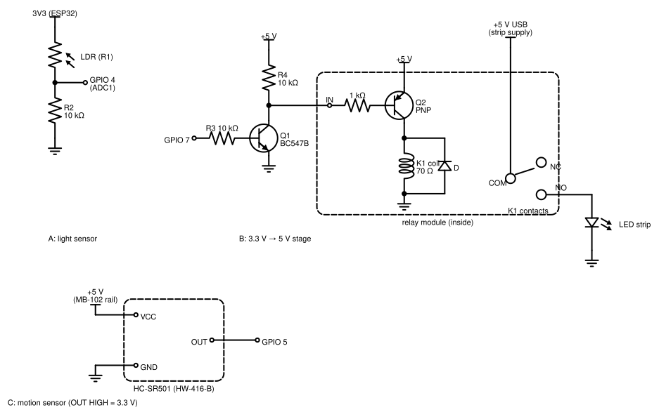
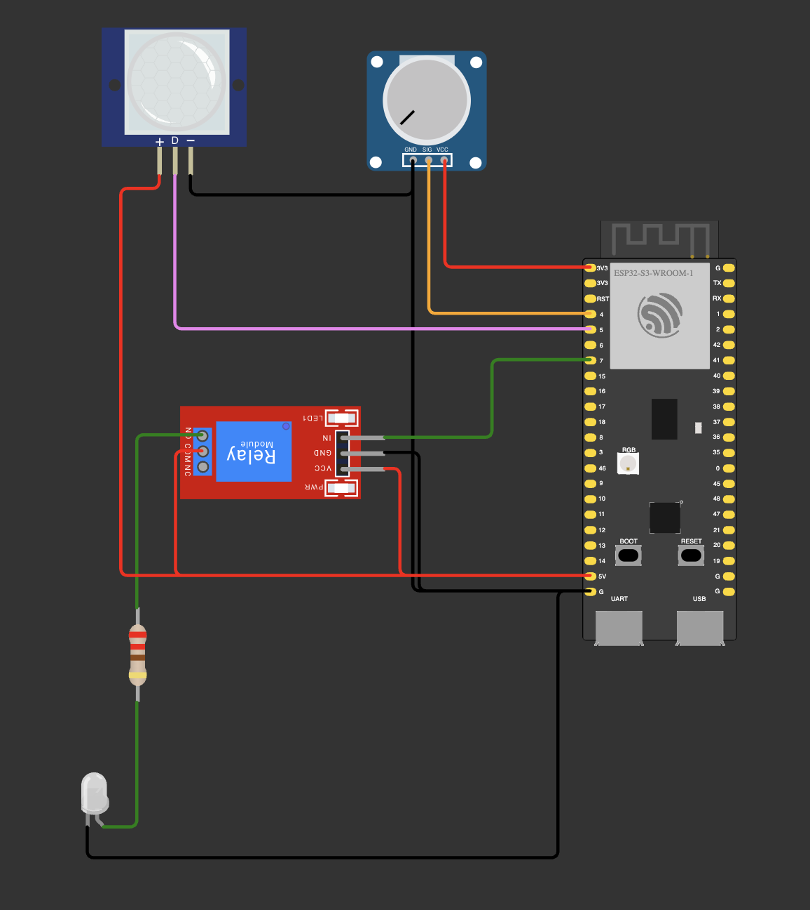

# 02 — Extra: the night light on the home Wi-Fi (a status page and a mode switch)

Step 01's night light joins the home Wi-Fi and serves a page at `http://nightlight.local/`: the light reading,
motion, the lamp with its countdown, a chart of the last 60 s of light, the last 10 events and three mode buttons
(auto / on / off). The circuit is step 01's: Wi-Fi adds no wires. Two things change in the lamp logic.

**Room light now switches the lamp off.** In step 01 light only blocked switching on. The rules in mode `auto`
(`Lamp::update()` is still the only code that writes GPIO 7):

- lamp off, dark and PIR OUT HIGH → lamp on (`lamp on (dark + motion)`);
- lamp on and light (raw above `THRESHOLD_LIGHT` = 2200, step 00's hysteresis) → lamp off at once
  (`lamp off (light)`); after that only the first rule switches it on again;
- lamp on, still dark, 15 s since the falling edge of PIR OUT → lamp off (`lamp off (no motion 15 s)`). Light is
  checked first.

**Modes.** `on` keeps the lamp on whatever the sensors say (`lamp on (mode on)`), `off` keeps it off
(`lamp off (mode off)`), `auto` runs the rules above. A switch applies at once: `mode -> auto`, then the lamp event
if the lamp changes. Every reset starts in `auto`; the mode is not stored.

## Setting up Wi-Fi

```
cp include/secrets.example.h include/secrets.h
```

Then put the network name and password into `include/secrets.h`. Git ignores every `secrets.h` (the root
`.gitignore`); only `secrets.example.h` is tracked. Without a `secrets.h` the build takes the example, Wokwi's open
network `Wokwi-GUEST`, and Serial says `Wi-Fi: no secrets.h, using secrets.example.h`: the CI build and Wokwi need
no real password.

The board joins in the background: `WiFi.begin()` returns at once. Every 5 s (`WIFI_CHECK_MS`) the firmware checks
the connection, logs `Wi-Fi connected, IP …` or `Wi-Fi lost`, and calls `WiFi.reconnect()` while it is down. After
the first connection it starts the web server and announces `nightlight.local` over mDNS. The lamp never waits for
any of it.

## The page and the API

| Request | Answer |
|---|---|
| `GET /` | the page: HTML, CSS and JS in one string in flash (`include/page.h`, 10 190 bytes) |
| `GET /api/state` | the state as JSON (below) |
| `POST /api/mode?m=auto` (or `on`, `off`) | 200 and the state JSON after the switch |
| `POST /api/mode` with any other `m` (`ON`, empty, `auto ` with a space) or without `m` | 400 `text/plain` `bad m: expected auto\|on\|off`, nothing changes |
| any other path, `GET /api/mode` too | 404 `not found` |

The page asks for `/api/state` once a second. An answer that takes more than 3 s is dropped, and a red "offline"
badge shows until the next answer; the chart keeps its points. Each answer adds one chart point, so the chart's x
axis counts answers, not seconds: a gap while offline doesn't show. The mode buttons POST, and a 400 text stays under
them until the next press or for 5 s.

A real answer from the board, shortened (3 of its 9 events, the IP hidden):

```json
{"uptimeMs":667561,"raw":1727,"dark":false,"darkBelow":1600,"lightAbove":2200,"motionAgoMs":54961,"lamp":false,
 "leftS":0,"mode":"auto","events":[{"atMs":5000,"text":"Wi-Fi connected, IP 192.168.…"}, …,
 {"atMs":535837,"text":"lamp on (dark + motion)"},{"atMs":542408,"text":"lamp off (light)"}]}
```

`raw` 1727 with `dark` false is the dead zone after light (step 00). `motionAgoMs` is `null` until the first
motion; `leftS` is the countdown, 0 outside `auto` or with the lamp off. Ten of the longest events give 926 bytes,
so the 1024-byte buffer fits (an overflow would answer 500 `json overflow`). Serial keeps step 01's status line
with `| mode: auto` at the end, and prints each event as `[  542.4 s] lamp off (light)`.

| File | What it does |
|---|---|
| `include/config.h` | as in step 01, plus `HOSTNAME` = `"nightlight"`, `WIFI_CHECK_MS` = 5000, `EVENT_COUNT` = 10 |
| `include/secrets.example.h` | the Wi-Fi template: copy it to `secrets.h` |
| `src/web.cpp` | Wi-Fi in the background, mDNS, the routes, the state JSON |
| `include/page.h` | the page |
| `src/event_log.cpp` | the last 10 events for the page, and one Serial line per event |
| `src/lamp.cpp` | the modes and the auto rules above |
| `src/main.cpp` | as in step 01, plus the mode in the status line; `Web::handle()` runs last in `loop()` |
| `src/light_sensor.cpp`, `src/motion.cpp` | unchanged from step 01 |

| Part | GPIO |
|---|---|
| LDR (other leg → 3V3) and 10 kΩ (other end → GND), their midpoint | 4 |
| BC547B base, through R3 = 10 kΩ ("GPIO Out") | 7 |
| HC-SR501 OUT (VCC on the breadboard supply's +5 V rail, GND common) | 5 |

The circuit is step 01's, unchanged:

```
3V3 ── LDR ──┬── GPIO 4 (ADC1)            GPIO 7 ── 10 kΩ (R3) ── B  BC547B
             │                                                    E ── GND
           10 kΩ (R2)                      +5 V ── 10 kΩ (R4) ──┬── C
             │                                                  └── relay module IN
            GND                            relay module VCC = +5 V, GND common

HC-SR501:  VCC ── +5 V (breadboard supply rail)     OUT ── GPIO 5     GND ── GND (common with the board)

Load, on its own supply: supply + ── COM, NO ── load +, load − ── supply −
```





**Wokwi** runs step 01's circuit with the same stand-ins. The board joins `Wokwi-GUEST`, but the page wasn't
reachable from the computer in this setup, so the routes were tested on the board.
[`wokwi-scenario.yaml`](wokwi-scenario.yaml) checks that Wi-Fi never holds up the lamp: potentiometer to dark → the
status line `dark | motion: never | lamp: off | mode: auto` from the first second with GPIO 7 LOW, then
`Wi-Fi connected, IP` (at 5.0 s), then the status lines go on, GPIO 7 still LOW. A copy expecting `mode: on` failed,
as it should. Local only, about 6 s of simulation.

## Measured on the board

The strip runs on its own USB 5 V through the relay (the red wire through COM / NO). The checks from the Mac used
`curl -4` (see the `.local` note below).

**Phone.** `http://nightlight.local/` opened and worked on a phone on the same Wi-Fi (checked by eye). The mode
switch was tested from the Mac, below.

**Requests** from the Mac; 20 POSTs took 17–174 ms, network included:

| Request | Result |
|---|---|
| `POST /api/mode?m=on` | 200, lamp on (27 ms) |
| `POST /api/mode?m=off` | 200, lamp off (22 ms) |
| `POST /api/mode?m=auto` | 200, the auto rules again (21 ms) |
| `m=ON`, `m=`, `m=auto%20`, `m=auto+`, no `m` (in mode `on`) | 400 `bad m: …`; mode, lamp and the event list read the same before and after |
| `GET /api/nope` | 404 |
| `GET /api/mode` | 404: only POST is routed (405 would be more exact) |

**Back to auto.** From `on` after more than 15 s without motion: in room light the lamp went off at once with
`lamp off (light)`, in the dark with `lamp off (no motion 15 s)`. The other half, `off` in the dark while waving and
then `auto` (the lamp should go on at once), was not run.

**More than 10 events.** 12 presses alternating `on` / `off`: exactly 10 events, oldest first, the last five
presses (`mode -> off`, `lamp off (mode off)`, `mode -> on`, …). Not compared with the Serial lines.

**The strip's own light.** This is the risk of the new light rule: if the strip lights the LDR above 2200, the lamp
switches itself off. Raw in a dark room, the strip switched on through mode `on` for 15 s, a reading every 0.6 s:

| Placement | Strip off | Strip on |
|---|---|---|
| first | 916 | 2247–2336 within 0.6 s: above 2200 |
| LDR shielded from the strip | 795–841 | 1011–1055 |

The first placement made the loop. The board's event list showed it twice in a dark room: `lamp on (dark + motion)`,
then `lamp off (light)` 4.9 s and 6.6 s later. An earlier run on the board did the same: raw 621 → lamp on → 2186,
2197 → `lamp off (light)` 1.9 s later (the status lines show one reading a second; a reading between them crossed
2200).

With the shield, a 180 s recording (a request a second) held the lamp on in the dark for about 150 s at raw
1064–1739, with no `lamp off (light)`. When the lamp went off there, raw fell from 1557 to 1048: in that position the
strip added about 500, more than in the 15 s run (the shield or the phone had moved; not checked). The margin to
2200 stayed above 460. Room light still reached the shielded LDR: 3167–3193, and the lamp went off with
`lamp off (light)`. A hand covering the LDR in room light, with motion, switched the lamp on: a cover reads as
dark.

**The page loses the board.** RST with the page open on the phone: "offline" showed, and the page came back by
itself with its chart. From the Mac (a request a second) the board didn't answer for 6.1 s and logged
`Wi-Fi connected` at 5.0 s of uptime. After a reset the event list is empty and the mode is `auto`: both live in RAM.

In the same 180 s, one request got no answer within 1 s, without a reset; the next one, 1.5 s later, did. The page
waits 3 s and wouldn't notice.

**Not run on the board.**
- *Wi-Fi drop* (router or hotspot off): the code logs `Wi-Fi lost` and calls `WiFi.reconnect()` every 5 s; the lamp
  rules don't depend on it. Not tried. Each `reconnect()` restarts the attempt in progress, so a network that needs
  more than 5 s to join may never come back.
- *A wrong password.* Wokwi shows that the lamp doesn't wait for the connection: status lines from the first
  second, Wi-Fi at 5.0 s (the scenario); in a scratch copy with a button in place of the PIR the lamp went on 1.5 s
  after reset, before Wi-Fi.
- *Timing with the page open.* Step 01 measured 3.5 µs from PIR OUT to the relay pin. Serving a request runs in the
  same `loop()` (below), so a request in progress delays the lamp. Even with no request, `handleClient()` sleeps
  1 ms on every call (WebServer 2.0.17, `enableDelay` is on by default), so once Wi-Fi is up `loop()` runs about once
  a millisecond and the reaction becomes up to about 1 ms. `server.enableDelay(false)` would remove that sleep. Not
  measured with the analyzer.
- *`off` → `auto` in the dark while waving* (above).

**Notes**
- **No login.** Anyone on the home network can switch the lamp: the page has no password and the board doesn't
  check where a request comes from. Fine for a night light on a network you trust, not for anything that matters.
- **The mode and the events don't survive a reset.** Both are in RAM; every boot starts in `auto` with an empty
  list.
- **Why the exact match.** `m=ON` or `m=auto ` (a stray space: WebServer url-decodes `%20` and `+`) get a 400, not a
  guess. A script with a typo learns about it at once, and each mode has exactly one spelling.
- **ADC1, not ADC2.** GPIO 4 is on ADC1. The ESP32-S3 datasheet (4.2.2.1): the ADC2 analog functions can't be used
  together with Wi-Fi. The LDR on an ADC2 pin couldn't be read while Wi-Fi runs.
- **`.local` names.** The phone used here opened `nightlight.local`; not every phone or browser resolves `.local`.
  The IP is in the Serial line and the event `Wi-Fi connected, IP …`. On the Mac, `curl http://nightlight.local/`
  spent 5.0 s on the name lookup, and with `curl -4` 6 ms; the board answered in about 24 ms either way. macOS also
  asks for an IPv6 address that this board doesn't announce, and waits 5 s for it. With a 5 s timeout, the first
  POSTs gave up during the lookup and never reached the board (no `mode ->` event).
- **One request at a time.** `WebServer::handleClient()` keeps one connection; the next one waits. It runs in
  `loop()` after the lamp rules, and while it reads a request the loop waits: a slow client can hold it for up to
  the stream timeout per header line, and up to 5 s for a POST body (WebServer 2.0.17). Not seen here.
- **Brownout.** Wi-Fi transmits in current peaks well above the idle draw. On a long or thin USB cable the supply
  can dip far enough to reset the chip: Serial shows `Brownout detector was triggered` and the board boots again.
  Not seen here; use a short, good cable.
- **Keep the strip's light off the LDR.** Shield the LDR, then read raw with the strip on in the dark: it must stay
  well below 2200 (above).
- **After 49.7 days.** `millis()` wraps to 0 after 49.7 days of uptime. The lamp rules are wrap-safe
  (`now - last >= interval`), but the page computes an event's age as `uptimeMs - atMs` in JavaScript, which goes
  negative after the wrap: old events then show a wrong age.
- **PIR and Wi-Fi.** HC-SR501 modules are often reported to trigger falsely from Wi-Fi transmissions close to them.
  Not checked here: if the lamp switches on in a dark, empty room, move the PIR away from the board's antenna.
- **Open question: brief flashes.** A flash bright enough to read above 2200 (car headlights on the ceiling)
  switches the lamp off at once, and it stays off until the next motion. Not tested. A short delay or a moving
  average before the light rule would filter it, at the cost of a slower reaction to the room light.
