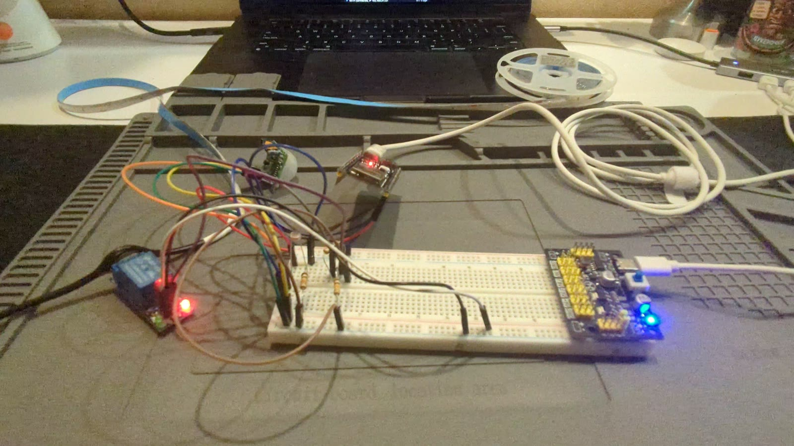
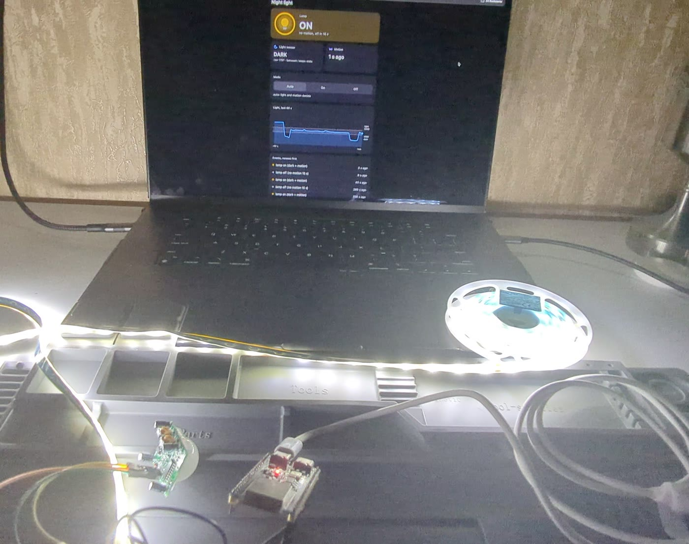

# Lesson 1.7 — Mini project: a sensor and an actuator. Homework: a twilight switch

[← Module 1](../)

**Board:** ESP32-S3 DevKitC-1 clone (N16R8) · **Framework:** Arduino (PlatformIO) · **Simulator:** Wokwi ·
**Logic analyzer:** 8-channel 24 MHz Saleae Logic clone (Logic 2)

**Assignment** ("Twilight switch on the ESP32-S3"): learn to read an analog signal from a voltage divider (ADC) and
to control an external load through a transistor switch (GPIO).

1. **Circuit**, built on the breadboard from the drawing. Input: the divider R1 (LDR) + R2 (10 kΩ) on the +3.3 V
   rail, its midpoint to "GPIO In" (ADC). Switch, matching 3.3 V to 5 V: "GPIO Out" through R3 (10 kΩ) to the base
   of a BC547B; the collector pulled up to +5 V through R4 (10 kΩ) and connected to the relay module's IN.
   Output: any safe low-voltage load (an LED, a 5 V / 12 V LED strip) on the relay's NO contact.
2. **Program**, three steps in the main loop: read the ADC from GPIO In (0…4095); compare it with two thresholds:
   below `THRESHOLD_DARK` (dark) → HIGH on GPIO Out (relay on), above `THRESHOLD_LIGHT` (light) → LOW (relay off),
   in between → change nothing, which protects the relay from chatter.

The extra steps that follow grow it into a motion-activated night light with a page on the home Wi-Fi.

## Result

The homework is step [`00`](00-base-twilight-switch/), built as assigned and checked on the board. Steps
[`01`](01-extra-motion/) and [`02`](02-extra-web/) are extras on the same circuit.

**Video** (88 s): the circuit, a wave switching the strip on in the dark, the page on the laptop:
[the night light working](https://photos.app.goo.gl/2JDyznYFtzUbMdvv6) (Google Photos).





| Assignment | Where to see it |
|---|---|
| LDR + 10 kΩ divider on an ADC pin | GPIO 4 (ADC1); [schematic](00-base-twilight-switch/schematic.svg), wiring table in [`00`](00-base-twilight-switch/) |
| 3.3 V → 5 V switch: R3, BC547B, R4 → relay IN | the same schematic; why IN can't take 3.3 V straight: "Why not 3.3 V straight on IN" in [`00`](00-base-twilight-switch/) |
| A safe low-voltage load on NO | a USB 5 V LED strip on its own USB supply, through COM / NO |
| Read the ADC, two thresholds, change nothing in between | [`light_sensor.cpp`](00-base-twilight-switch/src/light_sensor.cpp), thresholds in [`config.h`](00-base-twilight-switch/include/config.h) |
| Thresholds that fit the real circuit | "Light levels" in [`00`](00-base-twilight-switch/): 1600 / 2200 kept, every case at least 700 codes from the threshold that would flip it |
| No relay chatter | the logic analyzer: exactly one relay edge per change of light ([capture](00-base-twilight-switch/capture.png)) |

Measured on the board in the extras:
- PIR OUT → relay pin in 3.5 µs; the lamp goes off 14.99989 s after the last motion (`01`, logic analyzer);
- the lamp's own light: the unshielded strip lifted the LDR to 2247–2336, above the 2200 threshold, so the lamp
  switched itself off; a shield brought it to 1011–1055 (`02`);
- the page: 20 mode requests answered in 17–174 ms, wrong input → 400 and nothing changes, "offline" on a reset
  and back by itself (`02`).

**How it was debugged.** Serial lines with timestamps, the logic analyzer (Logic 2, captures saved in `00` and
`01`), Wokwi simulations with test scenarios, a Falstad model of the electrics Wokwi can't simulate (`00`, `01`),
and a multimeter. The ESP32-S3's built-in USB JTAG debugger was not used.

The circuit (GPIO In = GPIO 4, GPIO Out = GPIO 7; +5 V from a breadboard power supply, one common ground):

```
3V3 ── LDR ──┬── GPIO 4 (ADC1)            GPIO 7 ── 10 kΩ (R3) ── B  BC547B
             │                                                    E ── GND
           10 kΩ (R2)                      +5 V ── 10 kΩ (R4) ──┬── C
             │                                                  └── relay module IN
            GND                            relay module VCC = +5 V, GND common

Load, on its own supply: supply + ── COM, NO ── load +, load − ── supply −
```

## Steps

| # | Step | Type | What it shows |
|---|---|---|---|
| 00 | [base-twilight-switch](00-base-twilight-switch/) | base | the homework: two thresholds with hysteresis switch the relay; calibrated on the board, no chatter on the logic analyzer |
| 01 | [extra-motion](01-extra-motion/) | extra | a PIR on GPIO 5: the lamp switches on only in the dark with motion, off 15 s after the last motion; the timeout and its restart measured on the logic analyzer |
| 02 | [extra-web](02-extra-web/) | extra | the home Wi-Fi: a page at `nightlight.local` (light chart, events, countdown) and an auto / on / off switch; room light now switches the lamp off; the API and the strip's own light measured on the board |

Step 02 also switches the lamp off when the room light comes on (`lamp off (light)`); steps 00 and 01 keep their own rules.

## Working with the steps

Every step is an ordinary PlatformIO project: `platformio.ini`, `include/` + `src/`, and a Wokwi circuit. The
design and the plan the steps were built from are in [`docs/`](docs/) (each with an "as built" note).

- **Build / Upload:** open the step's folder in VS Code (or add it to the workspace) and use the PlatformIO
  buttons, or from the terminal: `pio run -d 00-base-twilight-switch`.
- **Simulate:** build the step first, then open its `diagram.json` and press ▶. A potentiometer stands in for the
  light, and the relay module sits straight on GPIO 7 without the transistor, so Wokwi runs the code but not the
  real circuit.
- **Serial:** 115200 baud on the board's UART USB-C port; `monitor_filters = time` puts the wall-clock time on
  every line, which matches the lines to a logic analyzer capture.
- **Capture:** `00` has a Logic 2 capture (`capture.sal`) with GPIO 7 and the decoded UART.
- **Capture:** `01` has `capture.sal` too: GPIO 7, the PIR's OUT on GPIO 5 and the decoded UART around one 15 s timeout.
- **Falstad:** `00` also has `falstad.txt`, a model of the circuit's electrics (the link is in its README).
- **Falstad:** `01` has one too, with the PIR as a push button and the firmware's rule and 15 s timer as gates and a
  capacitor.
- **Test:** `00` has `wokwi-scenario.yaml` (light → dark → dead zone → light → dead zone, checking GPIO 7);
  run it from the step folder with `wokwi-cli . --scenario wokwi-scenario.yaml` (about 4 s of simulation).
- **Test:** `01` has `wokwi-scenario.yaml` (dark and light without motion: the lamp stays off); the Wokwi PIR part
  can't be triggered from a scenario. Run it the same way, local only.
- **Test:** `02` has `wokwi-scenario.yaml` (the status line runs before and after the board joins Wi-Fi). Run it the
  same way.
- **Wi-Fi:** `02` needs `include/secrets.h` with your network: copy `include/secrets.example.h` and fill it in (git
  ignores it). Without it the step builds for Wokwi's open network. The page is at `http://nightlight.local/`.
- **Safety:** low voltage only. The load has its own supply, never the board's 5V pin or the breadboard supply.
