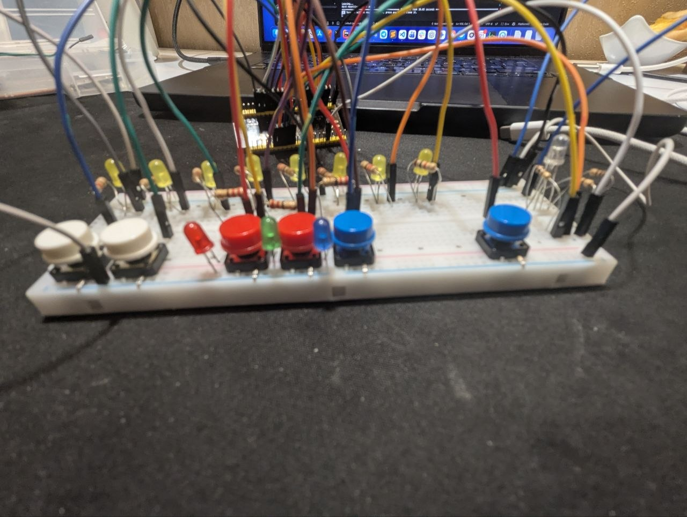
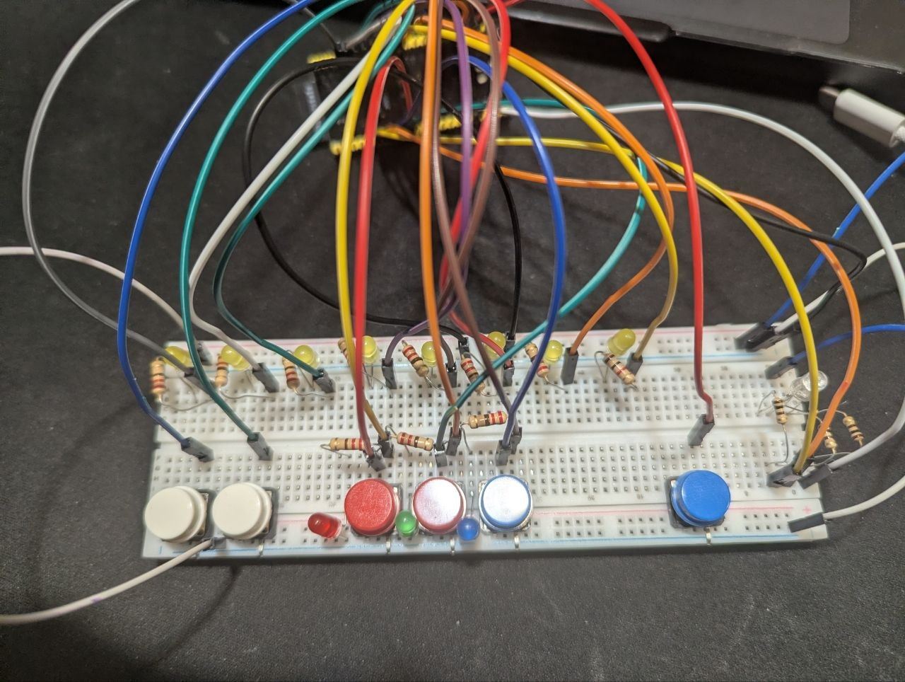
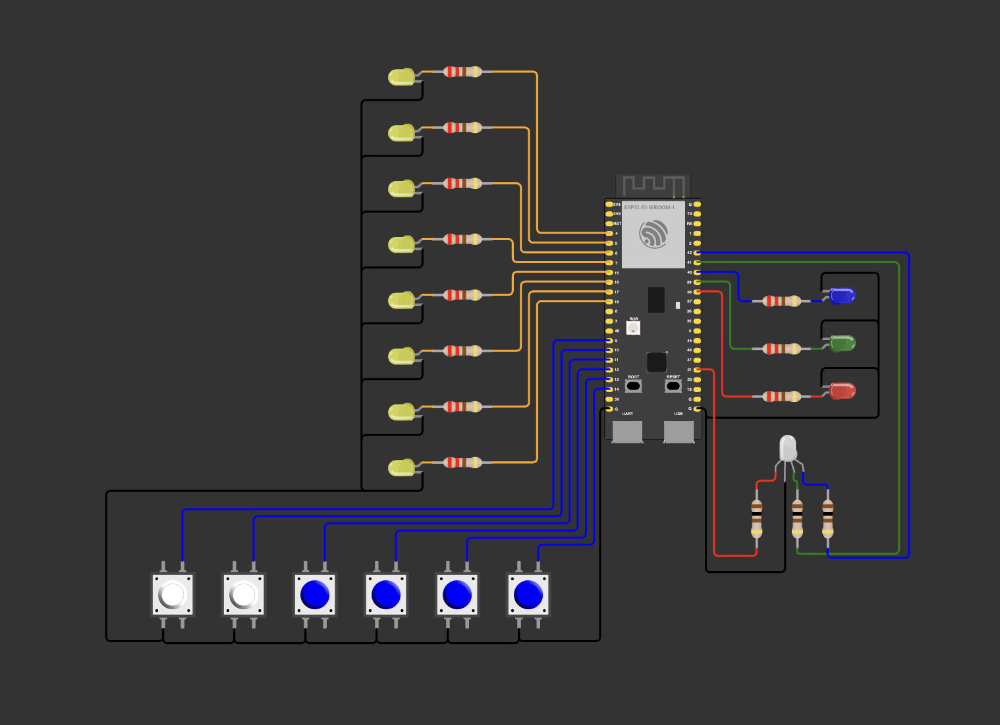

# RGB byte UI — eight LEDs, six buttons and an RGB LED

[← Module 1](../)

**Board:** ESP32-S3 DevKitC-1 clone (N16R8) · **Framework:** Arduino core 2.0.17 (PlatformIO) · **Simulator:** Wokwi
(the finished circuit only; every step was checked on the real board)

An extra Module 1 mini project, outside the course program: a hardware colour picker. Eight LEDs show a byte, six
buttons edit it bit by bit, and the three bytes light an RGB LED, the same three numbers as CSS `rgb(160, 64, 0)`
entered in binary. One ordinary PlatformIO project; every step is one commit, so the git history shows the progress.

**Assignment** (translated in full), "A UI that shows the bytes for RGB":

> Eight LEDs in a row: a UI that shows the bytes for RGB that the user enters.
>
> Button 1 shifts THE BIT cyclically to the left.
> Button 2 stores the active bit at its position.
> Buttons 3–5 store the current byte as the code for R, G, B respectively.
>
> When button 3–5 is pressed, the UI indicates the current setting. On the second and later presses it stores.
>
> Button 6 lights the last stored configuration on the RGB LED.

**Video:** [the RGB byte UI working](https://photos.app.goo.gl/JwuxbfXB5fYq9xqC6) (Google Photos).

## What it does

The eight LEDs show the byte of the selected channel, bit 7 on the left, bit 0 on the right
(160 = `1010 0000` = `●○●○○○○○`). One bit is the cursor: its LED blinks, 250 ms on and 250 ms off, over a 0 and over
a 1 alike, so while the cursor sits on a bit, that bit's value shows only once the cursor moves on.

| Button | Does |
|---|---|
| 1 | Moves the cursor one bit left; from bit 7 it wraps to bit 0. |
| 2 | Toggles the bit under the cursor in the selected channel. The channel changes at once (autosave). |
| 3, 4, 5 | Select channel R, G, B: the eight LEDs show that channel's byte, the cursor returns to bit 0. The button of the channel already selected only returns the cursor to bit 0. |
| 6 | Lights the RGB LED with the three channel values as they are at that moment (PWM, 0–255 each). Later edits reach the RGB LED only with the next press of 6. |

Next to buttons 3–5 a red, a green and a blue LED show which channel is selected: only that one is lit.
At power-on and after a reset: R = G = B = 0, R selected, cursor on bit 0, RGB LED dark. The values live in RAM, so a
reset clears them (keeping them in flash was planned as step 07 and dropped).

Every press is logged on Serial (115200 baud): `press N: cursor_position = …`, `toggle: R = …, G = …, B = …`,
`chosen_channel = …` (0 = R, 1 = G, 2 = B), `rgb: R = …, G = …, B = …`.

**Where it departs from the assignment:**
1. **No separate "store" press.** Button 2 changes the selected channel directly, and 3–5 only select. Followed
   literally, the first press of 3–5 would replace a byte typed before it with the stored value, and button 6 with
   nothing stored would look broken.
2. **Three channel indicators added:** nothing else on the board shows which channel is selected.
3. **The cursor is drawn on top of the byte**, blinking: the assignment doesn't say how the active bit is shown.

## Wiring

| GPIO | Part | How it is wired |
|---|---|---|
| 4, 5, 6, 7, 15, 16, 17, 18 | byte LEDs, bit 7 … bit 0 | GPIO → 220 Ω → LED → GND; bit 0 (GPIO 18) is the rightmost |
| 9 | button 1, move the cursor | GPIO → button → GND, internal pull-up (`INPUT_PULLUP`): pressed reads LOW |
| 10 | button 2, toggle the bit | the same |
| 11, 12, 13 | buttons 3, 4, 5: R, G, B | the same |
| 14 | button 6, light the RGB LED | the same |
| 38, 39, 40 | indicator LEDs: red, green, blue | GPIO → 220 Ω → LED → GND |
| 21, 41, 42 | RGB LED: R, G, B | GPIO → 100 Ω → leg; LEDC channels 0, 1, 2, 5 kHz, 8-bit duty |
| GND | RGB LED common leg | common cathode, measured with the multimeter's diode test |

The Wokwi circuit (`diagram.json`, `wokwi.toml`) is the finished project, not a step: build, then ▶ in the diagram
editor. Two things differ from the breadboard: the byte LEDs stand in a column (bit 7 on top), and Wokwi's
DevKitC-1 model has its own RGB LED on GPIO 38, so the red indicator's pin lights that one too.
`wokwi-scenario.yaml` presses all six buttons and checks the Serial lines and the indicator pins; it runs locally
only (`wokwi-cli . --scenario wokwi-scenario.yaml` in this folder), not in CI.

The RGB LED's legs were cut to one length, so the common leg was found with the diode test, not by its length: in a
row the legs are R, common, G, B. The 220 Ω resistors ran out, so it got 100 Ω: red takes about 13 mA, green and
blue about 3 mA, all within the 20 mA a pin gives at the default drive strength.

GPIO 39–42 are also the chip's JTAG pins, but by default the ESP32-S3 routes JTAG to its built-in USB Serial/JTAG
controller, so they work as ordinary GPIO (ESP-IDF guide, JTAG debugging → Tips and Quirks, "Can JTAG pins be used for
other purposes?"; ESP32-S3 datasheet, Table 3-5). 26–37 (flash/PSRAM), 19/20 (USB), 0/3/45/46 (strapping), 43/44 (UART0) and 47/48 (onboard LEDs, unverified)
are avoided.

## How the code works

`loop()` does two things on every pass:

1. **Draws everything from the state.** The selected channel's byte with the cursor on top (`|` lights the cursor's
   bit, `& ~` darkens it, depending on the blink phase `(millis() / 250) % 2`), each LED written with a bit test
   (`display_byte & 32`), and the three indicators (`chosen_channel == CHANNEL_G`).
2. **Every 20 ms, reads the six buttons.** A press is "HIGH last time, LOW now", so one press acts once however long
   the button is held, and bounce shorter than 20 ms is never seen. Each button keeps its own previous level. A
   press only changes the state: button 1 shifts the cursor (`<< 1`; the `uint8_t` overflows from 128 to 0, which
   is the cue to wrap to 1), button 2 toggles a bit (`^`), 3–5 set the selected channel.

Button 6 is the only one that touches hardware directly: three `ledcWrite` calls, after which the LEDC peripheral
keeps generating the PWM on its own, with nothing to repeat in `loop()`. There is no `delay()` anywhere: it would
stop the button reading while it waits.

## Steps (commits)

| Step | Commit | What it adds |
|---|---|---|
| 00 | [`3487edb`](https://github.com/alex-rns/EMB27/commit/3487edb) | The eight LEDs show a byte fixed in the code |
| 01a | [`3dcce74`](https://github.com/alex-rns/EMB27/commit/3dcce74) | Checkpoint: presses of button 1 counted on Serial |
| 01 | [`6601943`](https://github.com/alex-rns/EMB27/commit/6601943), [`1055277`](https://github.com/alex-rns/EMB27/commit/1055277) | Button 1 moves the cursor; one log line per press |
| 02 | [`3c050f4`](https://github.com/alex-rns/EMB27/commit/3c050f4) | Button 2 toggles the bit under the cursor |
| 03 | [`1dbf276`](https://github.com/alex-rns/EMB27/commit/1dbf276) | Buttons 3/4/5 select R/G/B and light their indicator |
| 04 | [`9436c2d`](https://github.com/alex-rns/EMB27/commit/9436c2d) | Each channel keeps its own byte; a selection returns the cursor to bit 0 |
| 05 | [`5975f6d`](https://github.com/alex-rns/EMB27/commit/5975f6d) | Button 6 lights the RGB LED: the assignment's behaviour is complete |
| 06 | [`4ead3f5`](https://github.com/alex-rns/EMB27/commit/4ead3f5) | The cursor blinks |

Design and step plan: [`docs/rgb-byte-ui-design.md`](docs/rgb-byte-ui-design.md),
[`docs/rgb-byte-ui-plan.md`](docs/rgb-byte-ui-plan.md).

## What breaks on real hardware

- **The breadboard's power rails are split in the middle.** LEDs on the far half of the GND rail stay dark until a
  jumper bridges the gap.
- **A tactile button turned 90°** joins the wrong pair of legs: it reads as always pressed or never. The legs that
  are farther apart are joined inside the button.
- **A button to GND needs `INPUT_PULLUP`.** With `INPUT_PULLDOWN` the pin reads LOW pressed or not. A button pin must
  never be an `OUTPUT`: driven HIGH while the button is pressed, it is shorted to GND.
- **Two `#define`s with the same name:** the last one wins, the compiler only warns ("redefined"), and the other pins
  are never set up, so their LEDs stay dark.
- **The previous level not updated, or shared between buttons:** a held button acts every 20 ms, or one button's
  level fakes a press of another.
- **The cursor is a bit's weight, not its number.** Bit 0 is `1`; `0` means no bit at all: no cursor, and button 2
  toggles nothing (`x ^ 0 == x`).
- **Blue and green LEDs at 3.3 V** have about 3 V of forward voltage: they are dimmer than red with the same resistor,
  and the multimeter's diode test may not light blue at all.
- **The RGB LED's colours are not balanced:** with 100 Ω red takes four times the current of green and blue, and the
  eye's response to duty isn't linear (128 looks much brighter than half of 255), so a mix doesn't match the same
  `rgb()` on a screen.
- **A common-anode RGB LED** would need its common leg on 3V3, and the duty inverted: 255 dark, 0 full, lit at boot.
- **`ledcWrite(channel, duty)` takes the LEDC channel number first.** A slot value there (`ledcWrite(128, …)`) names a
  channel that doesn't exist; the core ignores it silently and the LED stays dark. `pinMode` after `ledcAttachPin`
  detaches the pin from the PWM.
