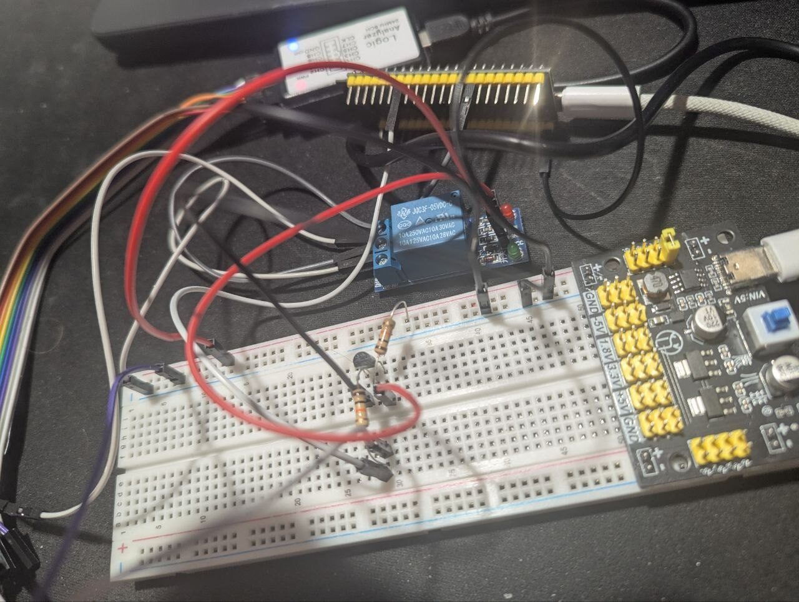
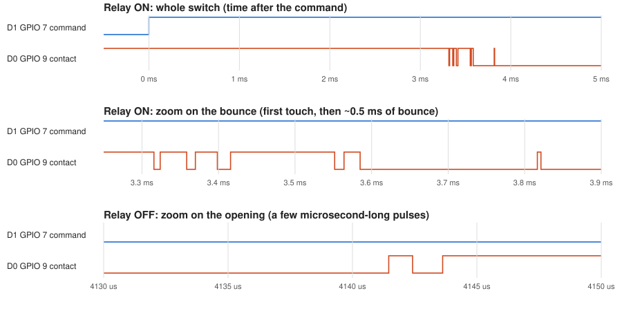

# 00 — Homework: relay switching delay on the ESP32

The required task of lesson 2.2: a GPIO drives a relay through a transistor, another GPIO reads the relay's dry
contact, and a pin interrupt timestamps the contact's first edge after each command. Written on ESP-IDF in C, not
the Arduino core. The git history of this folder shows the work one change per commit.

## Assignment

"Module 2.2. Homework" (translated in full).

**Requirements:** the code and the result on GitHub; the repository link in the LMS.

**Task 1: measuring the relay's switching time**

Connect a relay to the ESP32 and measure its mechanical switching delay:

- One GPIO drives the relay's coil (through a module or a transistor).
- Another GPIO reads the state of the relay's "dry" contact (use the `INPUT_PULLUP` mode).
- Measure the time with `micros()` (or `millis()`) and an interrupt (`attachInterrupt`).
- Note: account for the mechanical contact bounce when the interrupt fires!
- Take at least 10 measurements, print the results to the Serial Monitor and compute the average switch-on and
  switch-off times.

## How each point is done

ESP-IDF has no `micros()` or `attachInterrupt()`; the table names what the code uses instead.

| Point | In the code (`src/main.c`) |
|---|---|
| A GPIO drives the coil through a transistor | GPIO 7 (`gpio_set_level`) → 10 kΩ → BC547 base; the collector pulls the relay module's `IN` low |
| Another GPIO reads the dry contact, `INPUT_PULLUP` | GPIO 9: `gpio_set_direction(..., GPIO_MODE_INPUT)` + `gpio_set_pull_mode(..., GPIO_PULLUP_ONLY)`; the contact connects it to GND |
| `micros()` | `esp_timer_get_time()`: microseconds since boot, `int64_t` |
| `attachInterrupt` | `gpio_set_intr_type(GPIO_NUM_9, GPIO_INTR_ANYEDGE)` (= `CHANGE`), `gpio_install_isr_service(0)`, `gpio_isr_handler_add(GPIO_NUM_9, contact_isr, NULL)` |
| Contact bounce | the ISR `contact_isr` stores the time of the first edge only: it runs while `waiting` is `true` and sets it to `false`, so the bounce edges that follow change nothing |
| ≥ 10 measurements in Serial | every cycle prints `relay ON: contact closed after … us` and `relay OFF: contact opened after … us` (`printf` → the UART port) |
| Average switch-on / switch-off time | `sum_on`, `sum_off`, `count`: after every cycle the program prints the running average of all cycles so far |

A cycle where the contact doesn't change within 1 s (the relay has no power, say) is printed as skipped and left
out of the average.

## Wiring

| Part | Connection |
|---|---|
| GPIO 7 | 10 kΩ → BC547 base |
| BC547 emitter | GND |
| BC547 collector | relay module `IN`, plus a 10 kΩ pull-up to +5 V |
| Relay module `VCC` / `GND` | +5 V / GND (a breadboard power module; GND shared with the ESP32) |
| Relay contact COM | GND |
| Relay contact NO | GPIO 9 (internal pull-up) |

GPIO 7 high → the transistor conducts → `IN` goes low → the relay turns on (this module switches on a low `IN`).
GPIO 9 reads 0 while the contact is closed and 1 while it is open.

Serial: the **UART** USB-C port (CH343P, vendor ID 1A86), 115200 baud (`monitor_speed` in `platformio.ini`).



## Checked on the board

Serial output, relay powered before the board's reset:

```
relay ON:  contact closed after 3287 us
relay OFF: contact opened after 4143 us
average of 1: ON 3287 us, OFF 4143 us
...
relay ON:  contact closed after 3319 us
relay OFF: contact opened after 4107 us
average of 10: ON 3312 us, OFF 4122 us
```

| | 10 measurements, us | Average |
|---|---|---|
| ON | 3287 3308 3313 3312 3309 3315 3317 3322 3323 3319 | **3312 us ≈ 3.3 ms** |
| OFF | 4143 4132 4129 4127 4124 4120 4117 4113 4114 4107 | **4122 us ≈ 4.1 ms** |

The earlier busy-wait version (a `while` loop polling GPIO 9, in the history) gave the same: 3314 us and 4114 us.

**The bounce, seen with a logic analyzer** (24 MS/s; D1 = GPIO 7 command, D0 = GPIO 9 contact):



- **ON:** the first touch 3315.7 us after the command (the code printed 3312 us for the same kind of cycle), then
  ~505 us of bounce, 11 edges, before the contact stays closed.
- **OFF:** the contact opens at ~4141 us and chatters for only 2–9 us, 3–5 edges, some pulses as short as 0.12 us.
- So the interrupt really fires many times per switch-on; only the first edge goes into the result.

**Notes**
- **First cycles after start-up:** if the relay module gets its 5 V after the ESP32 has started, the first cycles
  wait for that power and print huge times; power the relay first, then reset the board.
- **`volatile` on `edge_time` and `waiting`:** the ISR writes them and `app_main` reads them; without `volatile` the
  compiler may keep a stale copy in a register.
- **A 64-bit value shared with an ISR:** `int64_t` takes two 32-bit accesses, so a read can be cut in half by the
  interrupt. Here it can't happen: the ISR writes `edge_time` once, shortly after the command, and `app_main` reads it
  a second later.
- **`IRAM_ATTR` on the ISR:** the ISR code stays in RAM, so it can run even while the flash cache is off.
- **Interrupt latency and very short pulses:** the ISR's timestamp lands a few microseconds after the real edge, and
  pulses shorter than the interrupt can follow (the 0.12 us ones at OFF) may be missed; neither changes the first
  edge's time by more than a few microseconds.
- **The relay contact is the slow part:** 3–4 ms is thousands of times longer than the code's reaction time, which is
  why the busy-wait and the interrupt versions agree.
