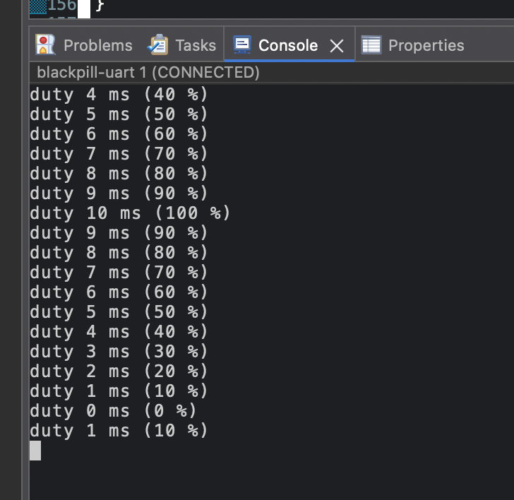

# 01 — Homework (bonus): software PWM on the STM32 (Black Pill)

The lesson 2.2 bonus task on the WeAct Black Pill (STM32F411CEU6): the main loop switches PB0 on and off itself (a
software PWM timed by `HAL_GetTick()`), PB0 drives a blue LED through a BC547 transistor switch, and two buttons step
the duty cycle up and down. Written in C inside the `USER CODE` blocks of CubeMX's `main.c`. The git history of this
folder shows the work one change per commit.

## Assignment

"Bonus homework 2.2" (the teacher's written version in the group chat, translated in full):

- Implement a software PWM (with delays or millis).
- The PWM drives an LED through a transistor.
- Two buttons that set the PWM's duty cycle.
- Add the calculation of the resistors.

## How each point is done

| Point | In the code (`Core/Src/main.c`) |
|---|---|
| Software PWM with millis | `HAL_GetTick()` (milliseconds from the 1 ms SysTick) is the `millis()`; `now % PWM_PERIOD_MS` is the position inside the 10 ms period, and PB0 is high while it is below `duty_ms`. No `HAL_Delay`: the loop never stops, so the buttons are read on every pass |
| The PWM drives an LED through a transistor | PB0 (`PWM_OUT`) → 1 kΩ → BC547 base; the LED and its 220 Ω resistor sit between +5 V and the collector |
| Two buttons set the duty cycle | PB1 (`BTN_UP`, external button) adds 1 ms, PA0 (`BTN_DOWN`, the board's KEY) takes 1 ms off; the duty stays within 0–10 ms (0–100 %), 11 levels |
| The resistor calculation | see [Resistor calculation](#resistor-calculation) |

Each button counts a press on the change from released to pressed (edge detection), not while it is held, and has its
own debounce: a change of its level is accepted only 30 ms (`DEBOUNCE_MS`) after the previous accepted one.

Not asked for, added to see the result: the duty is printed over USART2 whenever it changes
(`duty 4 ms (40 %)`).

## Resistor calculation

```
+5 V ── 220 Ω ── LED (blue) ── collector   BC547   emitter ── GND
                                     base ── 1 kΩ ── PB0 (3.3 V when high)
```

**LED resistor.** The 5 V from the breadboard power module splits between the resistor, the LED and the transistor.
The LED and the saturated transistor each take a nearly fixed voltage; the rest lies on the resistor and sets the
current.

| | Value | Source |
|---|---|---|
| Vf of a blue LED | ≈ 3.0 V | typical for a blue 3 mm LED (no datasheet for the kit's LEDs) |
| Vce(sat) of the BC547 | ≈ 0.2 V | a saturated transistor works as a closed switch with a small drop |
| LED current | 10 mA | bright enough for an indicator LED, half the usual 20 mA maximum |

R_LED = (5 − 3.0 − 0.2) V / 10 mA = **180 Ω** → the next value up in the kit, **220 Ω** (a larger resistor gives a
smaller, safer current): I_LED = (5 − 3.0 − 0.2) V / 220 Ω ≈ **8.2 mA**.

**Base resistor.** For a switch the transistor must saturate. The BC547B's current gain (hFE) is 200–450 but varies
from part to part and with temperature, so a switch is designed for a forced gain of 10: I_B = I_C / 10.

| | Value |
|---|---|
| I_C | 8.2 mA (the LED current) |
| I_B = I_C / 10 | 0.82 mA |
| PB0 high | 3.3 V |
| Vbe | ≈ 0.7 V (0.68 V measured on this BC547 with the multimeter's diode test) |

R_B = (3.3 − 0.7) V / 0.82 mA ≈ **3.2 kΩ**. The kit has 1 kΩ and 10 kΩ:

| R_B | I_B | |
|---|---|---|
| 10 kΩ | 0.26 mA | a third of the needed 0.82 mA: the transistor would likely still switch (hFE ≥ 200), but by luck, not by the rule |
| **1 kΩ** | **2.6 mA** | three times the needed current: saturated with margin |

So **1 kΩ**: for a base resistor the smaller value is the safe side. A larger one gives too little base current, the
transistor stays half open, drops more voltage, warms up and the LED is dimmer. PB0 supplies 2.6 mA, far below the
25 mA limit for one pin (STM32F411CE datasheet, absolute maximum ratings, I_IO).

## Project

A CubeIDE project generated by CubeMX into this folder; our code lives only in the `USER CODE` blocks of
`Core/Src/main.c`, which a regenerate keeps.

| Pin | CubeMX setting | Used for |
|---|---|---|
| PB0 | GPIO output, push-pull, no pull, low; label `PWM_OUT` | the transistor's base, through 1 kΩ |
| PB1 | GPIO input, pull-up; label `BTN_UP` | button to GND: duty up |
| PA0 | GPIO input, pull-up; label `BTN_DOWN` | the board's KEY button (PA0 → 330 Ω → GND): duty down |
| PA2 / PA3 | USART2, asynchronous, 115200 8N1 | TX to the USB-TTL adapter (RX unused) |
| PA13 / PA14 | SYS: Serial Wire | SWDIO / SWCLK for the ST-Link |
| PH0 / PH1 | RCC: HSE crystal | 25 MHz crystal |

**Clock:** HSE 25 MHz → PLL (M = 12, N = 96, P = 2) → SYSCLK 100 MHz. No timer is used: the PWM counts SysTick's
milliseconds. STM32Cube FW_F4 V1.28.3, CubeMX 6.18.1, CubeIDE 2.2.0.

## Wiring

| Part | Connection |
|---|---|
| PB0 | 1 kΩ → BC547 base |
| BC547 emitter | GND |
| BC547 collector | LED cathode (short leg, flat side) |
| LED anode (long leg) | 220 Ω → +5 V (a breadboard power module) |
| Button | PB1 and GND, on two diagonal legs |
| Black Pill `G` | breadboard GND (shared ground with the 5 V module) |
| PA2 | USB-TTL adapter `RXD`; adapter `GND` → `G`; the adapter's VCC stays unconnected |
| SWD header | ST-Link V2: 3.3V, SWDIO, SWCLK, GND; the board runs from the ST-Link |

PB0 high → the transistor conducts → the LED is on. PB1 and PA0 read 1 while released and 0 while pressed.

Serial: the adapter's port (`/dev/cu.usbserial-*` on macOS), 115200 baud; CubeIDE shows it in a Console of the type
Command Shell Console → Serial Port.

## Notes

- **Period and resolution.** 10 ms (100 Hz) is fast enough that the eye sees a steady, dimmer LED. With 1 ms ticks the
  period holds only 11 duty levels; finer steps or a higher frequency would need a faster time base (a timer counting
  microseconds, as in the relay task).
- **Edge, not level.** The loop runs many thousands of times during one press, so "while pressed, add 1" would jump to
  the maximum at once. A press is counted on the change from released (`GPIO_PIN_SET`) to pressed (`GPIO_PIN_RESET`).
- **Debounce on both edges.** Without it one press sometimes added 2 (seen on the board, 922f2c6). Filtering only the
  press is not enough: the release bounces too, and a bounce back to "pressed" during a release would count as a new
  press if the button had been held longer than 30 ms. So every change of the level waits 30 ms after the previous
  accepted change, and the remembered level only takes accepted changes.
- **Each button has its own memory.** One shared "last state" would let a press on one button reset the other's
  filter.
- **The lower limit protects from a wrap.** `duty_ms` is `uint32_t`: `0 - 1` gives 4294967295, and the LED would light
  fully after the press that should turn it off. Hence `duty_ms > 0` before `duty_ms--`.
- **Wrap of `HAL_GetTick()`.** `now - last_up_change >= DEBOUNCE_MS` with `uint32_t` stays right when the millisecond
  counter wraps after about 49.7 days; `now >= last + DEBOUNCE_MS` would not.
- **The print stalls the PWM.** `HAL_UART_Transmit` waits until the line is sent: the longest line, `duty 10 ms
  (100 %)\r\n`, is 20 characters × 10 bits at 115200 baud ≈ 1.7 ms. It happens only once per change of the duty, so
  at most one period is stretched per press.
- **`%lu` for `uint32_t`**, `%%` for a literal `%`. In arm-none-eabi-gcc `uint32_t` is `unsigned long`; `%u` would give
  a `-Wformat` warning.

## Checked on the board

- Fixed duty (deef7f7): the LED is lit steadily and dimly, no visible flicker.
- `BTN_UP` without debounce (922f2c6): one press sometimes moved the duty two steps.
- With debounce (aa16636): 7 presses take the duty from 3 to 10 ms (full brightness), one step per press; holding and
  releasing changes nothing.
- `BTN_DOWN` (bc1a21e): KEY lowers the duty to 0 (LED off) and further presses keep it off; both buttons together step
  up and down one level per press.
- A wiring fault on the way: PB1 read 1 even with the button held (`IDR1` = 1 read through the ST-Link, with `MODER1`
  = input and `PUPDR1` = pull-up confirmed), so the button never reached GND. Rewiring the button fixed it.

Serial output (fcbd758) while pressing `BTN_UP` up to 100 %, then KEY down to 0 % and `BTN_UP` once more:



Build (Debug, `-O0 -g3`): 0 errors, 0 warnings with CubeIDE's flags and with `-Wextra`. `arm-none-eabi-size`: `text`
11252, `data` 92, `bss` 1972 bytes. The generated project alone had `text` 7568; the PWM and both buttons add about
250 bytes, and `snprintf`'s formatting code about 3.4 KB (7820 → 11252).

## Working with the step

- **Open:** in CubeIDE, File → Open Projects from File System → this folder (opened in place, not copied into the
  workspace).
- **Build:** Project → Build Project (the hammer).
- **Flash:** Run → Run As → STM32 C/C++ Application, with the ST-Link connected. Launch files (`*.launch`) hold
  absolute paths and are not committed, so the first Run creates one.
- **Change pins or the clock** in `01-homework-soft-pwm-stm32.ioc` with CubeMX, then regenerate: everything in
  `main.c` outside the `USER CODE` blocks is rewritten.
