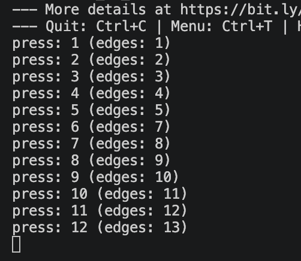
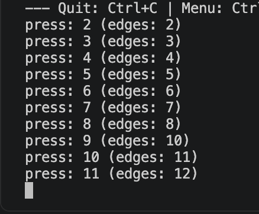
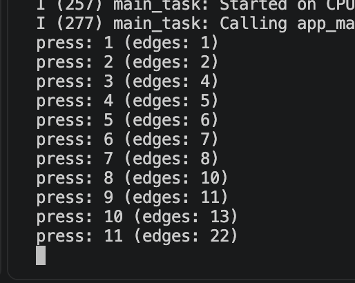
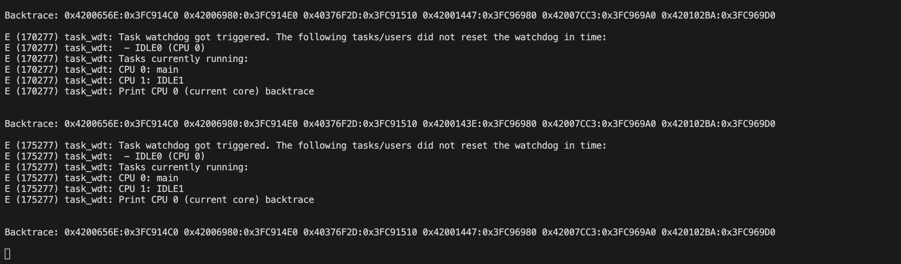

# 00 — Homework: button debounce on the ESP32-S3

The lesson 2.4 homework on the ESP32-S3, in C on ESP-IDF (the assignment allows the Arduino framework or ESP-IDF).
A button on GPIO 7 with an external 10 kΩ pull-up; each task replaces the previous method in the same `src/main.c`,
one commit per task, so the **commits are the tasks** and the final code is task 4. The task 3 interrupt code stays in
the final file, commented out.

The same lesson on the Black Pill (task 3 and the extra STM32 tasks) is in
`../00-homework-button-debounce-stm32/`.

## Assignment

The teacher's text in the LMS, translated in full.

**Homework: removing button contact bounce**

Code and the result on GitHub; the link to the repository in the LMS. Use the Arduino framework or ESP-IDF.

**Task 1: Basic implementation (no debounce, done in class)**
- Set up a GPIO interrupt on FALLING.
- On every interrupt: increment a counter; print the counter to the log.

Expected result: one physical press gives several interrupts; the interrupt also fires when the button is released.

**Task 2: Software debounce with a timer (time-based)**
- Add a time-based debounce: ignore an interrupt if less than 50 ms have passed since the previous one.
- Implement it outside the ISR.

Expected result: fewer false triggers; triggers on release are still possible.

**Task 3: Debounce by checking the level (state-based)**
- The interrupt only signals "an event".
- In `loop()` / a task: accept the event only if the button is still pressed; ignore events on release.

Expected result: exactly one reaction to one press; a release causes no action.

**Task 4: Polling + debounce (no interrupts)**
- Remove the interrupt completely.
- Poll the button every 5–10 ms.
- Implement the debounce as a state machine.

Expected result: the most stable behaviour; a slightly longer reaction delay.

**Task 5: Hardware debounce**
- Add an RC filter (a 100 nF capacitor and a 100 Ω resistor, the 10 kΩ pull-up unchanged).
- Repeat parts 1–4.
- Compare the results with and without the RC.

**Task 6: Comparison table**

| Method | Number of false triggers | Delay | Complexity | Comment |
|---|---|---|---|---|
| No debounce | | | | |
| Time-based | | | | |
| State-based | | | | |
| Polling | | | | |
| Hardware RC | | | | |

## How each point is done

| Task | Commit | In `src/main.c` |
|---|---|---|
| 1. No debounce | 80725ca, f9ddde5 | `gpio_set_intr_type(BUTTON_PIN, GPIO_INTR_NEGEDGE)`, `gpio_install_isr_service(0)`, `gpio_isr_handler_add(BUTTON_PIN, button_isr, NULL)`. The ISR `button_isr()` (`IRAM_ATTR`) only does `counter++` on a `volatile uint32_t`; the `while (true)` loop in `app_main()` reads `counter` once per pass and prints it when it changed. f9ddde5 adds `vTaskDelay(pdMS_TO_TICKS(10))` to the loop (see Notes, task watchdog) |
| 2. Time-based | 3cd37a0 | the ISR is unchanged. When the loop sees new edges, it reads `esp_timer_get_time()` and counts a press only if 50 ms (50000 µs) or more have passed since the last accepted press; the edges are marked handled either way. All outside the ISR |
| 3. State-based | e422a01 | new edges only store the time and set `event_pending`. 50 ms after the last edge the loop reads `gpio_get_level(BUTTON_PIN)`: 0 (still pressed) counts a press, 1 means the edges came from a release and nothing happens |
| 4. Polling | 1f6e345 | the interrupt setup is commented out. Every 10 ms the loop reads the pin; a state machine with two states (`stable` = 1 released, 0 pressed) switches only after 5 reads in a row (50 ms) differ from the current state, and counts a press when it switches to pressed. A read equal to the state resets the count |
| 5. Hardware RC | — | not done yet; it comes in a later commit |
| 6. Table | — | comes with task 5 |

The log: task 1 prints `count: N` (interrupts so far), tasks 2 and 3 print `press: N (edges: M)`, task 4 prints
`press: N`.

## Wiring

| Part | Connection |
|---|---|
| Button | GPIO 7 and GND, on two diagonal legs |
| Pull-up | 10 kΩ between 3V3 and GPIO 7 |

GPIO 7 reads 1 while released and 0 while pressed. The internal pull-up is off (`GPIO_FLOATING`), so the external
10 kΩ is the only pull-up, as the assignment's task 5 expects.

## Checked on the board

Presses counted by hand, the log read from the UART port at 115200 baud.

| Task | Presses | Result |
|---|---|---|
| 1. No debounce | 10 | 21 interrupts; one 10 ms pause of the loop held six edges (the count jumped from 2 to 8) |
| 2. Time-based | 10 | 12 presses counted, 13 edges: one bounce edge was filtered (edges 5 → 7), two extra presses came from release bounce after the 50 ms window, as the assignment expects |
| 3. State-based | 11 | 11 presses counted, 22 edges: one press brought 9 edges (13 → 22) and still counted once; releases counted nothing |
| 4. Polling | 10 | 10 presses counted |

The bounce changes from run to run (task 1: 21 edges for 10 presses; task 2: 13), so the numbers compare the methods
only roughly. An earlier task 3 run counted 11 presses for 12 edges with the presses not counted, and an earlier task 4
run, with some presses made very sharply, counted 7 with the presses not counted: a tap shorter than 50 ms is rejected
as bounce (from the code; the tap length was not measured).

Task 2 (time-based):

Task 3 (state-based), the two runs:

The task watchdog before `vTaskDelay` was added:

Build: every task's commit builds with 0 warnings with `-Wall -Wextra` on our code. Platform espressif32 7.1.3 with
ESP-IDF 6.1.0 (`framework-espidf` 4.60100.0) and GCC 15.2 (`toolchain-xtensa-esp-elf`). The final code (task 4)
uses 15388 bytes of RAM and 174425 bytes of flash.

## Notes

- **A floating pin counts by itself.** With the internal pull-up off and the external 10 kΩ not yet wired, the
  interrupt counter rose with nobody touching the button: 3099 → 3359 in 4 s.
- **`gpio_reset_pin()` turns the internal pull-up on.** So `gpio_set_pull_mode(BUTTON_PIN, GPIO_FLOATING)` comes after
  it, to leave only the external 10 kΩ.
- **The task watchdog.** `app_main()` runs in a FreeRTOS task; a `while (true)` that never waits keeps the idle task on
  CPU 0 from running, and the task watchdog printed `task_wdt: ... IDLE0 (CPU 0)` every 5 s. With
  `vTaskDelay(pdMS_TO_TICKS(10))` in the loop (the ESP-IDF counterpart of Arduino's `delay(10)`) a 12 s capture showed
  no `task_wdt` line. The ISR keeps counting during the pause.
- **The ISR's signature.** `gpio_isr_handler_add()` takes a `gpio_isr_t`, `void (*)(void *arg)`. This toolchain
  compiles C as C23 (`-std=gnu23`), where an empty `()` means `(void)`, so `void button_isr()` is an incompatible
  pointer type and the build fails; `void button_isr(void *arg)` is right.
- **`IRAM_ATTR` needs `esp_attr.h`.** Without the include the compiler sees an unknown word and reports
  `expected ';' before 'void'`.
- **`%lu` for `uint32_t`.** Here `uint32_t` is `unsigned long`, so `%u` gives a format warning.
- **One read of `counter` per pass.** The ISR can change it at any moment, so the loop copies it once and works with
  the copy; `volatile` makes each read go to memory.

## Working with the step

- **Build:** `pio run -d module-2/2.4-hardware-interrupts/00-homework-button-debounce-esp32` (or open it in the
  workspace and use the PlatformIO buttons).
- **Flash and log:** connect the UART port (the CH343P one), then Upload and Monitor at 115200 baud. Close the
  monitor before uploading: it holds the port, and the upload fails.
- **Walk the tasks:** `git log -- module-2/2.4-hardware-interrupts/00-homework-button-debounce-esp32`, then check out
  a task's commit to build that version.
