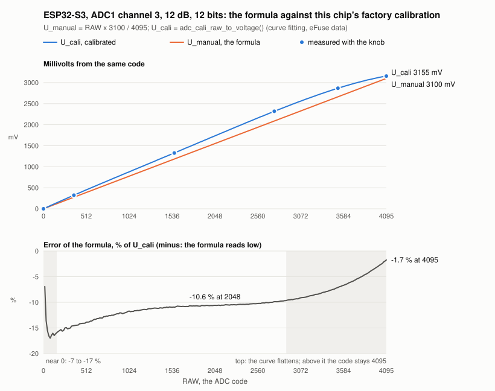

# 02 — Homework: the ESP32-S3's ADC, the formula against the factory calibration

[← Lesson 3.2](../)

The lesson 3.2 homework: a potentiometer divider on ADC1 is read in oneshot mode every 100 ms, and each reading is
turned into millivolts twice, with the textbook formula and with the chip's factory calibration. A table on the
serial console shows both and the formula's error in %. The optional part prints both conversions for the whole code
range at start and plots them, which shows where the ADC is not linear. ESP-IDF in C (PlatformIO, ESP-IDF 6.1), one
`src/main.c`; the git history of this folder builds it one change per commit.

## Assignment

Lesson 3.2 homework: calibrating the ADC data.

The code and the result go to GitHub. The repository name (or the branch, or a commit message) must contain the module
number and the lesson number. The link to the repository goes into the LMS.

Task:

- Connect a potentiometer (~10 kΩ) as a voltage divider.
  - Take the reference voltage, the attenuation and the resolution into account. They can go into the table too,
    for information.
- Set up the ADC and read the value every ~100 ms.
- Make several measurements. For each one:
  - read the raw ADC value and compute the voltage with the formula;
  - read the voltage with the calibrated ADC;
  - compute the error (%) between the computed and the calibrated voltage.
- Print a table to the serial console. Example:

```
RAW   U_manual(mV)   U_cali(mV)   Error(%)
------------------------------------------
 512      412.1          398        3.55
1024      824.2          801        2.89
2048     1648.4         1589        3.74
3072     2472.6         2398        3.10
```

Optional:

- Make plots.
- Find the nonlinear regions (visually).

## How each point is done

| Point | Where | How |
|---|---|---|
| The potentiometer as a divider | wiring | its ends to `3V3` and `GND`, the middle pin to GPIO 4 (ADC1, channel 3); no other part |
| Reference, attenuation, resolution | `main.c`, the table below | 12 dB attenuation (`ADC_ATTEN_DB_12`) gives an input range of 0..3100 mV; 12 bits give codes 0..4095; the formula uses both: RAW × 3100 / 4095. The internal reference is the chip's own, about 1100 mV; the calibration accounts for it |
| Read every ~100 ms | `main.c` | `adc_oneshot_read()` in a loop with `vTaskDelay(100 ms)` |
| The voltage by the formula | `raw_to_mv_manual()` | U_manual = RAW × 3100 / 4095 |
| The calibrated voltage | `main.c` | `adc_cali_create_scheme_curve_fitting()` once (the factory's data in the chip's eFuse), then `adc_cali_raw_to_voltage()` for each reading |
| The error in % | `error_percent()` | (U_manual - U_cali) / U_cali × 100, as in the example; minus means the formula reads low; `n/a` when U_cali is 0 |
| The table on the serial console | `main.c` | one row every 100 ms, the header every 20 rows (115 200 baud) |
| Optional: plots | `print_curve()`, [img/calibration.svg](img/calibration.svg) | at start the firmware prints both conversions for every 16th code (`CURVE,...` lines, 257 points, saved in [img/calibration-curve.csv](img/calibration-curve.csv)); the plot is drawn from them |
| Optional: the nonlinear regions | the plot | near 0 and from about code 2900 (below) |

## Settings

| Setting | Value |
|---|---|
| ADC | ADC1, channel 3 = GPIO 4, oneshot mode |
| Attenuation | 12 dB: input range about 0..3100 mV (Espressif, ESP32-S3); the calibrated accuracy is given as ±50 mV up to 2900 mV |
| Resolution | 12 bits: 0..4095 |
| Reference | internal, by design 1100 mV, from 1000 to 1200 mV between chips (Espressif); the factory measures it and stores it in eFuse |
| Calibration | ESP-IDF's curve fitting scheme with this chip's eFuse data |
| Reading | every 100 ms |

## Results

Measured with the knob held still at six positions; each row is the median of about 20 readings (2 s). The raw
reading wanders by a few tens of codes at a fixed position (1555–1591 at the second one).

| RAW | U_manual (mV) | U_cali (mV) | Error (%) |
|---|---|---|---|
| 0 | 0.0 | 0 | n/a |
| 363 | 274.8 | 323 | -14.92 |
| 1562 | 1182.5 | 1326 | -10.82 |
| 2757 | 2087.1 | 2318 | -9.96 |
| 3517 | 2662.4 | 2866 | -7.10 |
| 4095 | 3100.0 | 3155 | -1.74 |

The formula reads low everywhere: it gives 0.757 mV a code (3100 / 4095), while this chip's calibration gives about
0.85 mV a code in the middle of the range. The error is not constant, so the real curve is not a straight line.



The six measured points lie on the calibrated curve: both conversions depend only on the code, so a measurement only
picks a point on two fixed curves. That is why the whole curve can be printed at start without turning the knob.

**The nonlinear regions** (the shaded bands of the lower plot):

- **Near 0, the first ~150 codes:** the error jumps from -7 % to -17 % and back up. At the knob's end the ADC reads 0,
  and the calibration gives 0 mV for it, so the error is undefined there.
- **From about code 2900 to 4095:** the calibrated curve bends; its slope falls from about 0.85 to about 0.44 mV a
  code above code 3800, and the error shrinks to -1.7 % at 4095. This is also the region Espressif doesn't give an
  accuracy for (above 2900 mV). Code 4095 is calibrated to 3155 mV, and a higher input reads 4095 too: the last part
  of the knob's turn, up to 3.3 V, all reads 4095.
- **In the middle** the error changes slowly, from about -14 % at code 512 to about -10 % at 2900.

## Wiring

| Part | Connection |
|---|---|
| Potentiometer, 10 kΩ | one end to `3V3`, the other to `GND`, the middle pin to GPIO 4 |
| USB | the board's UART port (the CH343P bridge) for flashing and the serial console |

## Notes

- **The API is ESP-IDF 6.1's, not the lesson's.** The lesson text uses ESP-IDF 4.4 (`adc1_config_*`,
  `esp_adc_cal_characterize()`, `esp_adc_cal_raw_to_voltage()`, `ADC_ATTEN_DB_11`). PlatformIO's espressif32 7.1.3
  brings ESP-IDF 6.1, where those are gone: `adc_oneshot_*` reads, `adc_cali_*` calibrates, and 11 dB is now called
  12 dB (`ADC_ATTEN_DB_12`).
- **3100 mV is the recommended range, not where the code reaches 4095.** On this chip the code reaches 4095 at about
  3155 mV (calibrated). A formula built on 3.3 V (as the example table seems to be: 412.1 / 512 is 0.805 mV a code)
  would be closer in the middle (1562 × 3300 / 4095 = 1258.8 mV, -5.1 %) and read high at the top (3300 mV at 4095,
  +4.6 %).
- **Which value is right is not checked here.** The calibrated value is the factory's; a multimeter on GPIO 4 would
  show the real voltage.
- **Without eFuse calibration data** `adc_cali_create_scheme_curve_fitting()` fails, and `ESP_ERROR_CHECK` restarts
  the chip in a loop. This chip has the data.
- **The potentiometer's ends:** at the 0 V end the reading is 0, and above about 3.15 V (calibrated) it is 4095.

## Checked on the board

| Check | Result |
|---|---|
| RAW while the knob turned | the whole range, 0 to 4095 (165 readings in 15 s) |
| The formula | RAW 1642 gave 1243.0 mV: 1642 × 3100 / 4095 = 1243.0 |
| The table | one row every 100 ms, the header every 20 rows; at RAW 1642: -10.77 % = (1243.0 - 1393) / 1393 × 100 |
| Six knob positions | the results table above |
| The curve at start | 257 `CURVE` lines, from code 0 to 4095 |

The build: `pio run` with `-Wall -Wextra` for our code gives 0 warnings (espressif32 7.1.3, ESP-IDF 6.1.0).

## Working with the step

- **Open:** `EMB27.code-workspace` in VS Code; it holds this project, so the PlatformIO buttons work.
- **Build and flash:** PlatformIO → Upload, with the board's UART port connected.
- **Watch the table:** PlatformIO → Monitor (115 200 baud). The `CURVE` lines come right after a reset.
