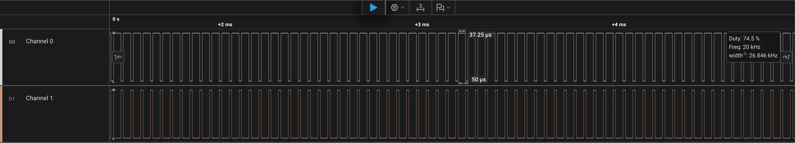

# 01 — Homework: a potentiometer sets an LED's brightness and a DC motor's speed (LEDC PWM)

[← Lesson 3.3](../)

The lesson 3.3 homework on the ESP32-S3, built like the [lecture's STM32 project](../00-lecture-pwm-stm32/): one PWM
timer, two outputs. LEDC timer 0 runs at 20 kHz; channel 0 drives a small DC motor through a 2N2222 (GPIO 5), channel 1
an LED (GPIO 6) with its output inverted, like TIM1's CH1N in the lecture. ADC1 reads a potentiometer every 100 ms, and
the reading sets both channels' duty: the knob speeds the motor up and dims the LED. ESP-IDF in C (PlatformIO,
ESP-IDF 6.1), one `src/main.c`; the git history of this folder builds it one change per commit.

```
GPIO 4 pot ──► ADC1 oneshot, every 100 ms ──► duty = raw * 2048 / 4000 (above 4000: 2048 = 100 %)
                                                   │
LEDC timer 0 (20 kHz, 11 bits) ──► channel 0 (GPIO 5) ──► 2N2222 ──► motor
                               └─► channel 1 (GPIO 6, inverted) ──► LED
```

## Assignment

Homework: pulse-width modulation (PWM).

The code and the result go to GitHub. The repository name (or the branch, or a commit message) must contain the module
number and the lesson number. The link to the repository goes into the LMS.

Task:

- A potentiometer controls an LED's brightness.
- A potentiometer controls the speed of a motor's shaft.
- The motor and the LED don't affect each other's work.

## How each point is done

| Point | Where | How |
|---|---|---|
| The potentiometer controls the LED's brightness | `main.c`, the loop | `adc_oneshot_read()` every 100 ms; the reading becomes a duty (0..2048), `ledc_set_duty()` + `ledc_update_duty()` write it to channel 1 (GPIO 6). The channel's output is inverted (`flags.output_invert`), so the LED is on for the rest of the period: the knob up, the LED dimmer. At 20 kHz the eye sees the brightness, not blinks |
| The potentiometer controls the motor's speed | `main.c`, the loop | the same duty goes to channel 0 (GPIO 5), which switches the motor through a 2N2222: the knob up, the motor faster |
| The motor and the LED don't affect each other | `main.c`, the wiring | each has its own LEDC channel and pin. The motor runs from its own 5 V supply (a MB-102 breadboard supply, the grounds joined), so its current doesn't load the `3V3` rail that feeds the ESP32 and the LED; a flyback diode across the motor takes its turn-off current. Checked by stalling the shaft by hand (below) |

One knob sets both, as in the lecture: the motor's duty and the LED's are complementary (the LED gets 100 % minus the
motor's share). The duty is one value for both channels; the LED's inversion is done by the pin's output stage.

## Settings

| Setting | Value |
|---|---|
| LEDC timer | timer 0, low-speed mode (the S3's only one), 20 kHz, 11 bits (duty 0..2048, 2048 = always high), clock chosen by the driver (`LEDC_AUTO_CLK`: APB 80 MHz) |
| Motor channel | channel 0, GPIO 5, starts at 25 % until the first reading |
| LED channel | channel 1, GPIO 6, the same timer and duty, output inverted |
| ADC | ADC1 channel 3 = GPIO 4, oneshot mode, 12 dB attenuation (about 0..3.1 V), 12 bits (0..4095), every 100 ms |
| Knob to duty | duty = raw × 2048 / 4000; above 4000: 2048 (100 %), like the lecture's `adc_value / 4` clamped at 4000 |
| Serial | 115 200 baud, one line per reading: `raw 2085 duty 1067` |

**Why 20 kHz and 11 bits.** The LEDC timer divides its 80 MHz clock by at most 1024 (`LEDC_TIMER_DIV_NUM_MAX`, ESP-IDF
6.1), and by no less than 1: frequency × 2^bits must stay between 80 MHz / 1024 and 80 MHz. 20 kHz × 2^11 = 41 MHz
fits; 12 bits would need 82 MHz. The first commits ran at 10 Hz (14 bits, the S3's widest; 10 Hz needs at least 13),
slow enough to see by eye, then 1 kHz, where the motor whined.

## Wiring

| Part | Connection |
|---|---|
| Potentiometer, 10 kΩ | its ends to `3V3` and `GND`, the middle pin to GPIO 4 |
| Motor driver | GPIO 5 → 220 Ω → the 2N2222's base; emitter to `GND`; collector to one of the motor's leads; the motor's other lead to +5 V (MB-102); a 1N4007 across the motor, its stripe (cathode) on the +5 V lead |
| LED | GPIO 6 → 220 Ω → LED → `GND` |
| Grounds | the MB-102's `GND` joined to the ESP32's `GND` |
| USB | the board's UART port (the CH343P bridge) for flashing and the serial console |

```
+5 V (MB-102) ──┬────────┐
              motor    1N4007, stripe up
                ├────────┘
            collector
GPIO 5 ─ 220 Ω ─ base     2N2222 (P2N2222A: C B E, flat side facing)
             emitter
                │
               GND (joined to the ESP32's)
```


The board's own 5V pin isn't used: on this clone it has no 5 V from USB while the `IN-OUT` pad is open.

## Checked on the board

Logic analyzer on GPIO 5 (channel 0) and GPIO 6 (channel 1), one row per commit:

| Commit | What was checked | Result |
|---|---|---|
| the motor channel | 10 Hz, 25 % | GPIO 5: 10.000 Hz, 100.005 ms period, 25.00 % high |
| the LED channel | inverted, the same timer | GPIO 6: 75.00 % high; its edges at GPIO 5's, the same microsecond |
| the ADC | the knob from end to end, on the serial console | 0 (with stray 25s) at one end, then 152, 327, 455, 654, 919, 1158, 1448, 1775, 2121, 2496, 2963, 3823, and 4095 at the other |
| the knob sets the duty | the knob near the middle | the console: raw 2045..2139, duty 8376..8761 of 16384 (51.1..53.5 %); the analyzer: GPIO 5 51.0..53.0 % high, GPIO 6 the rest (47.3..48.7 %); the knob at the end: raw 4095, GPIO 5 always high, GPIO 6 always low |
| 20 kHz | the frequency, the sound | 1 kHz first: 999.95 Hz, the motor whined. 20 kHz: 19 999 Hz, no sound; the LED's brightness follows the knob |

Logic 2 at 20 kHz, the knob turned high: channel 0 is GPIO 5 (the motor), channel 1 GPIO 6 (the LED). Logic 2's own
measurement of one pulse: 37.25 µs high in a 50 µs period, duty 74.5 %, 20 kHz; GPIO 6 is high for the rest.



**The motor's starting point at 20 kHz.** The knob turned up slowly from zero until the motor started; the analyzer
gave the duty there:

| Circuit | The motor starts at |
|---|---|
| 1 kΩ base resistor, the diode in series with the motor (a wiring mistake, found after the next row) | 97 % |
| 220 Ω base resistor, the diode in series | 87 % |
| 220 Ω, the diode across the motor (the circuit above) | 52 % |

At 10 Hz the same motor turned at 25 %.

**The motor and the LED don't affect each other.** With the knob at about 71 %, the motor's shaft held by hand for 2–3
seconds and released, the analyzer recorded 6 s: GPIO 5's duty 70.9..71.9 % and GPIO 6's 28.1..29.1 % in every half
second (the ADC's usual noise), the longest gap between edges 65 µs (a reset would stop the PWM for much longer). The
LED didn't flicker, and the serial console showed no restart.

## Notes

- **The diode goes across the motor, not in series with it.** In series it conducts the motor's current, so the
  motor still runs, but at turn-off the motor's current has no path: it drops to zero every period and has to build up
  again in the next pulse, and its energy hits the transistor's collector as a voltage spike. At 10 Hz the 25 ms pulses
  were long enough for the current to build up; at 20 kHz the motor started only at 97 %.
- **A stronger base current helps at 20 kHz.** 1 kΩ gives about 2.5 mA ((3.3 - 0.8) V / 1 kΩ): the transistor
  switches slowly and may not turn fully on at the motor's current. 220 Ω gives about 11 mA, within the GPIO's default
  20 mA drive (ESP32-S3 datasheet).
- **The frequency is a trade-off for a small motor.** 10 Hz blinks the LED; 1 kHz whines; 20 kHz is silent but the
  motor sees only the average voltage and starts at 52 % (52 % of 5 V is about 2.6 V). Below that the knob's turn does
  nothing to the motor. Long pulses at 10 Hz kick the gearbox with the full 5 V and start it at 25 %.
- **The 1N4007 is a slow rectifier diode.** A fast diode (1N4148 for small currents, a 1N5819 Schottky) suits a 20 kHz
  switch better; the kit's 1N4007 works here (the motor starts at 52 %), not compared with a faster one.
- **An undriven pin picks up the motor.** Before the LED channel was set up, GPIO 6 (an input then) showed a 1 µs low
  dip at each of the motor's turn-offs; once LEDC drove it, the dips were gone.
- **DUTY_MAX is 2^bits, not 2^bits - 1.** LEDC takes duty 0..2^bits, and 2^bits keeps the pin high the whole period,
  like CCR = ARR + 1 on the STM32.
- **`ledc_set_duty()` alone changes nothing on the pin.** `ledc_update_duty()` applies the new duty from the next
  period, like CCR's preload on the STM32.
- **The ADC reads 4095 before the knob's end** (3.3 V is above the 12 dB range of about 3.1 V), and wanders by a few
  tens of codes at a fixed position: the duty moves by about ±1 %, which neither the LED nor the motor shows.

## Working with the step

- **Build / Upload:** `pio run -d 01-homework-pwm-led-motor-esp32` (add `-t upload`), or the PlatformIO buttons with
  this folder in the VS Code workspace.
- **Serial Monitor:** the UART USB-C port, 115 200 baud (set in `platformio.ini`).
